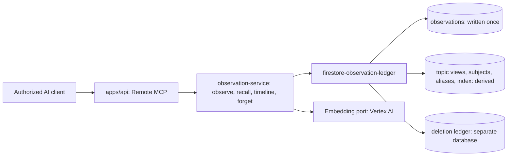

# Syntoria Lore architecture

## Access authentication

Cloudflare Access is the only authentication: `ACCESS_ISSUER`, `ACCESS_AUDIENCE` and
`ACCESS_OWNER_EMAIL` are required. The API independently verifies the RS256 assertion from
`Cf-Access-Jwt-Assertion`: fixed issuer, exact application audience, expiry,
issued-at, nonempty subject and owner email. Gateway user-info headers and the
backend IAM `Authorization` header do not establish application identity.

`OWNER_ADMISSION_ISSUER` and `OWNER_ADMISSION_SUBJECT` select an existing admission.
These are persistence coordinates, never claims copied from an Access token. The
API reads that admission without rewriting its tenant, scope, policy or historical
records. AI clients of the default connection at `/mcp` share one `shared-ai`
actor; a further connection at `/mcp/c/<id>` has its own actor, provisioned only by
`scripts/manage-connections.mjs`, and a request for an unprovisioned, inactive or
foreign connection returns the same `404`. The path selects a connection of the
admission; it never adds a grant. The stored `connectionId` and `gateClientId` fields
keep their earlier schema names. A missing
authorization of the default actor or the worker is created with every workspace and the
Inbox ([ADR 0012](docs/adr/0012-grant-workspaces-per-connection-and-classify-by-project.md));
an existing one changes only through `scripts/manage-connections.mjs`, and grants are
never unioned. Policy approval remains separate from AI proposal authority.

Deploy behind an API Gateway that verifies the same Access JWT and invokes Cloud
Run with a dedicated service account. Accept the backend hostname explicitly in
`MCP_ALLOWED_HOSTS`; do not trust request-supplied forwarded hosts. The gateway and
the Access application must cover `/mcp/c/*` as they cover `/mcp`. Access owns MCP
OAuth discovery, so the API serves no protected-resource metadata. The earlier Gate
introspection path was removed on 2026-11-14 and remains in Git history.

## Current state

Lore keeps a ledger of observations on Firestore, as [ADR 0010](docs/adr/0010-record-observations-and-derive-the-current-state.md) decides and the [observation ledger design](docs/design/observation-ledger.md) specifies. An AI writes an observation once; Lore never rewrites it and derives from the observations of a topic what is current, what it was before and when it changed. `apps/api` serves this over Remote MCP.

The Memory Records model of [ADR 0007](docs/adr/0007-store-memories-as-firestore-memory-records.md) that preceded it is no longer served. Its repository, value model and recall code remain in `packages/memory-records` because the ledger extends the repository and converts the records it holds; its collections are read only by that conversion. The PostgreSQL implementation before it was removed on 2026-11-09 and remains in Git history; pages that describe it are marked historical.

The ledger and the service were verified against the Firestore emulator with locally signed Access assertions and deterministic embeddings. What was observed on the hosted service is in the dated [evaluation records](docs/eval/); nothing here claims hosted behaviour.

## Recall responsibility

The outcome is relevant accumulated evidence being used in a new situation without repeated explanation. The domain service retrieves and selects authorized evidence; the MCP adapter exposes that contract, and the client initiates recall and uses the evidence. Retrieval success and client use must be evaluated separately.

Observation views retain original subject names and effective-until timestamps alongside provenance, aspect and source references. Client instructions request scoped application and supporting citations; they cannot enforce client tool initiation. The [full MCP evaluation](docs/eval/situational-recall-mcp-20261112.md) separates retrieval success from that client obligation.

## Contextual recall changes

The [situational recall contract](docs/design/situational-recall.md) defines intent-aware retrieval, eligible candidate recovery and matched historical evidence alongside current state; durable independent index recovery remains a release requirement. Contextual recall now fuses lexical and vector ranks without a semantic-only cap, preserves matched observations beside current topic state, and accepts full situational queries. Entity intent retains name precedence. Vector retrieval examines up to 1,000 candidates before eligibility filtering and retains up to 100 eligible candidates; this finite bound can still miss authorized evidence. Candidate exhaustion is reported. A process-local maintenance loop retries queues for authenticated scopes without further writes, backs off to 60 seconds, and drains before shutdown. Drained scopes are removed; at most 100 active scopes are tracked. It does not discover scopes after restart or guarantee progress while Cloud Run suspends CPU. Durable scheduled recovery and measured quality acceptance remain planned.

Optional contextual applicability assessment now runs in the domain after authorized candidate retrieval. The Vertex transport classifies bounded candidates; the domain validates complete assessments, retains conditional evidence, removes irrelevant items, and rechecks ledger visibility after inference. Annotations are fallible model interpretations and cannot alter source facts or authority. Failure explicitly falls back to unannotated retrieval. `RECALL_ASSESSMENT_MODEL` opts in with existing Vertex configuration; it is disabled when unset. Entity and historical intents bypass it. The [assessment contract](docs/design/situational-recall.md#optional-applicability-assessment-contract) defines limits and diagnostics. This is implemented capability, not hosted enablement or quality acceptance.

## Model

An observation states something about named subjects: a `state` that holds until it changes, or an `event` that happened. One aspect of one subject is a topic; its state observations, in time order, are its course. The view of a topic, the subject and alias tables and the search index are derived and can be rebuilt. Originals in other services are referenced by their own identifiers and never copied.

## Component ownership

| Area | Responsibility |
| --- | --- |
| `packages/memory-records/src/observations.ts` | The observation value model as pure functions: validation, tiers, and the course and view of a topic, which depend only on the set of observations and not on their order of arrival |
| `packages/memory-records/src/firestore-observation-ledger.ts` | The ledger on Firestore, a subclass of the repository: the write transaction (observation, subjects and aliases, topic view, change-feed entry), reads by subject, topic and time, bounded term and vector queries, links, source reports, writer suppression, Forget and purge of observations, and conversion of Memory Records |
| `packages/memory-records/src/observation-service.ts` | The operations adapters call: observe, recall, timeline, read, link, source report, Forget and change feed. Assembles recall from named subjects, term hits and vector hits, and after each write purges recorded Forgets, converts old records and indexes waiting observations without failing the write |
| `packages/memory-records/src/recall-assessment.ts` | Assessment contract, bounded execution, complete output validation and source-evidence enumeration; no model-generated authority or rewritten observations |
| `apps/api/src/recall-assessment.ts` | Vertex structured-output transport for applicability assessment; the domain owns filtering and fallback |
| `packages/memory-records/src/search-terms.ts` | Term derivation by script, name candidates of a query, selection of lookup terms and rarity-weighted term coverage |
| `packages/memory-records/src/firestore-repository.ts` | The Memory Records repository the ledger extends: authorization checks, idempotent request pins, per-scope sequence, change feed with signed cursors, Forget, purge, restore checkpoint. Its record commits and recall are no longer reachable from the service |
| `packages/memory-records/src/index.ts`, `derived-recall.ts`, `service.ts`, `capture.ts` | The Memory Records value model, recall, service and capture, kept for the conversion and for tests; not served |
| `packages/memory-records/src/access.ts` | Reads admissions (`memoryAdmissions`, keyed by a digest of the admission issuer and subject), creates a missing authorization of the default connection, its person or the worker with every workspace and the Inbox, denies a further connection whose authorization the operator tool did not write, never changes an existing one, and is the only code that mints a verified actor capability. Applies the admission's approval policy: `automatic` records a `policy` approval for the exact request digest; any other policy returns `user_required` |
| `packages/memory-records/src/firestore-deletion-ledger.ts` | The deletion ledger on its own Firestore database: append-only entries and a head that moves in the same transaction |
| `packages/memory-records/src/firestore-client.ts`, `runtime.ts` | Firestore client construction (Application Default Credentials, or a loopback emulator) and wiring of the two databases |
| `apps/api` | Node.js 24 HTTP service: `/healthz`, `/readyz`, stateless Streamable HTTP MCP at `POST /mcp` and `POST /mcp/c/<id>`, admission checks, body/rate limits, Access assertion verification, the Vertex embedding provider and optional recall assessor. Configuration is environment-only and fails fast |
| `packages/memory-records/src/labels.ts`, `workspaces.ts` and `scripts/manage-connections.mjs` | Workspace labels and the one visibility rule; the registry of workspaces and connections and the operator tool that is the only path to change a grant ([ADR 0012](docs/adr/0012-grant-workspaces-per-connection-and-classify-by-project.md)) |
| `packages/memory-records/src/queries.ts` | Placement queries (`and`, `or`, `not` over `workspace_id`, `project_id`, `scope` and `usable_in`) and the usability rule, compiled against the current hierarchy of the granted workspaces; a query selects within the allowance and is never a boundary |
| `packages/memory-records/src/projects.ts` | The pure rules of a workspace's project hierarchy: names unique under a parent, at most four levels, no cycles, paths computed from the current hierarchy. The ledger applies them in one transaction per change, refuses to delete a project that has children or observations, and records each change in the access history |
| `scripts/admit-subject.mjs` | Operator tool that creates or reactivates one admission with the `automatic` policy; it refuses to move an existing admission to another tenant or scope |
| `scripts/migrate-source-metadata.mjs` | Private, reviewed operator path for appending evidenced source metadata; its audit uses the credential-derived IAM identity and it is not exported through the API, service or runtime |

Each admitted connection writes as its own principal, set by the server. An observation records its workspace, project and scope; a scope wider than the narrowest is approved under the approval policy and recorded, and results carry the place, which is hidden for a Shared observation from a workspace the reader is not granted. The tier of an observation is derived from the write path: `person` when the approval policy grants the person's authority to a write that asks for it, `source` when it cites an original outside Lore, otherwise `inference`. Nothing waits for approval.

Not built: the REST adapter, a durable external worker (indexing, purge and conversion use in-process maintenance; restore reconciliation runs before protected operations), person confirmation of a protected change, a reviewed way to widen compartment allowances or revoke sources, an operator tool for writer suppression, and tracked deployment configuration.

## Correctness boundaries

- **An observation is written once.** A change is a new observation. The only later write to an observation is the mark that it was forgotten.
- **The present is derived, and the derivation is deterministic.** A topic's view is computed from its observations by rule, without a model, and gives the same result whatever the order of arrival. A rebuild must reproduce the stored view.
- **Authority comes from the verified actor.** Writer and tier are set from the actor and the write path; a request field cannot set them. A lower tier does not replace or retract a state of a higher tier; the disagreement stays visible as an open conflict.
- **Reads are bounded.** Every read is by key or a bounded query. Subjects are found through the alias table, topics by subject, and term and vector search return a bounded number of candidates; a term query that reaches its bound says that results are partial.
- **Rights apply at read time.** Allowance, source rights, suppression and writer suppression are checked on every observation before it is returned, including those a stored view names; when a reader may not see everything that went into a view, the view is computed from what that reader may see. Firestore server clients bypass Security Rules, and a lint rule confines the Firestore client to the repository, the ledger, the client factory, the deletion ledger, the access module and the workspace registry; there is no database-level backstop.
- **Forget denies first, purges later.** A Forget reports use stopped only after the independent ledger append is durable. Purge removes the observation, its index entry and its source reports and rebuilds the topic view. After a restore, a suppression named by the ledger hides an observation even when the restored document lacks its forgotten mark.
- **Sources are references.** Lore stores identifiers, a link, the version seen and when it was read. It never fetches a source, so it reports what readers found, not whether a source is unchanged.
- **Search is built in Lore.** Terms are derived by script; name and term matching and ranking run in the service over bounded candidates. Firestore Standard has no full-text search, and its vector index is flat; [ADR 0010](docs/adr/0010-record-observations-and-derive-the-current-state.md) accepts those limits.

## Runtime boundary

The runtime uses separate named Firestore databases for memory and the deletion ledger. Deployment accounts, project coordinates, service URLs and IAM bindings remain in ignored private configuration. The service uses verified Access assertions and an existing owner admission. The repository's implementation does not establish which revision or configuration is currently hosted. Follow [operations](docs/operations.md) for release checks, monitoring and rollback. A durable external maintenance worker remains unimplemented.

Syntoria Weave is a separate service for current shared state. Lore has no shared storage or required API dependency on Weave.

## Verification boundary

Unit tests check the value models, the service configuration and Access assertion verification. The emulator suite checks the ledger through a real MCP client with locally signed Access assertions, the workspace registry and its operator tool, and the Memory Records repository it extends. The emulator does not enforce composite or vector indexes and does not show managed IAM, transaction contention, latency, cost, managed restore or search quality; deterministic embedding doubles do not measure recall quality. The indexes the queries need are declared in [firestore.indexes.json](firestore.indexes.json). The [development guide](docs/development.md) lists verification commands, [operations](docs/operations.md) covers configuration and recovery, and the [evaluation guide](docs/eval/README.md) separates dated observations from acceptance.
