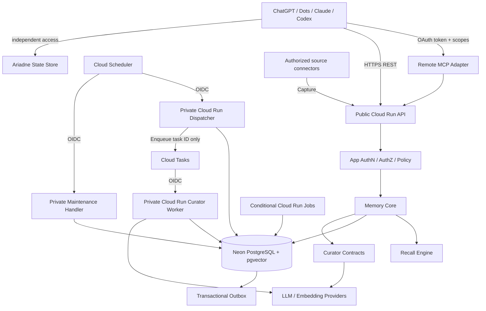
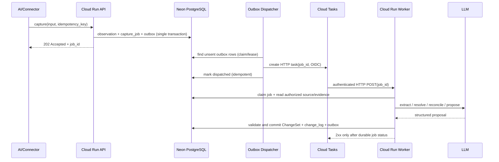
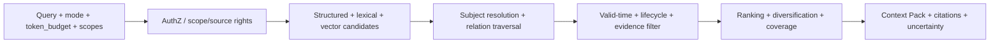

# Thymesis — Architecture

- Version: 1.0 (design baseline)
- Date: 2026-10-14
- Infrastructure decision: GCP Cloud Run + Cloud Tasks + Cloud Scheduler + Neon PostgreSQL (supersedes Cloudflare baseline)
- Decision record: [ADR-0001](docs/adr/0001-gcp-cloud-run-neon.md)
- Status: **Implementation specification; deployment/benchmarks pending**
- Product contract: [PRODUCT.md](PRODUCT.md)
- Delivery plan: [docs/DEVELOPMENT_PLAN.md](docs/DEVELOPMENT_PLAN.md)

## 1. Architecture decision

**採用：GCP Cloud Run (TypeScript/Node.js) + Cloud Tasks + Cloud Scheduler + Neon PostgreSQL (pgvector + pg_trgm) + model-agnostic LLM Curator + REST/Remote MCP.**

記憶とその履歴・関係・全文検索・ベクトルをPostgreSQLに集約し、トランザクションと認可を強固にする。専用Graph DBや外付けVector DBは導入しない。これはMVP暫定技術ではなく、PRODUCT.mdで定義する標準・高負荷ワークロードに対応する**完成形の技術ベースライン**とする。

追加サービスの導入条件は、受け入れ条件の未達を実測で示し、運用・費用・セキュリティを含めた改善が明確な場合だけとする。Cloud Run Jobsは30分を超えるバッチ再処理など、通常のCloud Tasks HTTP処理では完結できない処理に限って使う。

### Technology decisions and rationale

| Concern | Selected | Reason / constraint |
| --- | --- | --- |
| Public API / Remote MCP | **GCP Cloud Run service** (TypeScript/Node.js) | コンテナによる実装自由度、scale-to-zero、同一REST CoreをMCPアダプターから利用 |
| Private async consumer | **GCP Cloud Run service** | Cloud Tasksの認証済みHTTPターゲット。LLM呼び出し・索引更新をAPIと独立スケール |
| Source of truth | **Neon PostgreSQL** | ACID、制約・RLS・時間/履歴・Relation管理、マネージド運用 |
| Semantic search | **pgvector** in Neon | 正本と検索索引を同じPostgreSQLで管理。Embeddingは派生物 |
| Lexical/relationship | **pg_trgm + typed relation tables** | 日本語検索と必要な関係探索をRDBで実現 |
| DB access | **PostgreSQL TLS + Neon pooled endpoint** | Node.jsの標準PostgreSQLクライアントを使用。接続数を制限し、RLSをtransaction scopedに |
| Async delivery | **Cloud Tasks + transactional DB outbox** | OIDC認証、rate limit、retry。DBに確定したジョブを消失させない |
| Schedule / recovery | **Cloud Scheduler** | Outbox未配送回収、stale memoryの対象限定再評価、失敗ジョブの再投入 |
| Long/bulk processing | **Cloud Run Jobs, conditional** | 通常のCloud Tasks HTTP処理の30分上限を超えるreindex/backfill等 |
| LLM/Embedding | Provider adapter | Curator/Ranking/Embeddingをモデル依存にしない |
| API identity | OAuth 2.1-compatible authorization provider | MCP/REST委任トークンを検証する。独立した認証基盤として実装しない |
| Internal identity | GCP IAM + **OIDC service-account ID token** | Tasks/Scheduler → Private Cloud Runの呼出しを制限 |
| Scope defense | App authorization + PostgreSQL RLS | 認可されたOwner/Scope/Source権限を二重防御 |
| Secrets/observability | Secret Manager + Cloud Logging/Monitoring | 運用上の認証情報管理と障害検知。記憶本文はログへ出さない |

**Deployment baseline**

- 同一GCPプロジェクト内に公開APIと非公開Curatorを別Cloud Run serviceとして配置し、共通ドメインパッケージを利用する。デプロイ/スケーリングは独立させる。
- APIは外部の認証済みPersonal AIのためにHTTPS公開し、OAuthのissuer/audience/scopeを検証する。Curator/Dispatcher/Scheduled maintenanceは認証付きの内部呼び出し専用とし、GCP IAMを強制する。
- Cloud Runの`min instances=0`を標準とし、cold startがSLOを破る場合のみ最小インスタンス数を調整する。`max instances`・concurrency・request timeout・DB pool上限を明示設定する。
- Cloud Runは日本のユーザーからの遅延と原本データの地域要件を考慮して東京 (asia-northeast1) を第一候補とする。**Neonの利用可能な実リージョン・ホストプロバイダーとデータ所在を確認し、地理的な近接を優先**する。GCP内同居やリージョン一致を仮定しない。
- Neonは別のプロバイダーに管理されるため、通信遅延・外部通信コスト・データ地域・プール上限・PITR/バックアップ条件を環境構築時に確認する。
- Cloud TasksのHTTP targetは**最大30分**（デフォルト10分）。長時間単位の処理はチェックポイント化、またはCloud Run Jobsで実行。Cloud Run service自体の最大リクエストタイムアウト（60分）をTasksへそのまま適用しない。
- Cloud TasksはQueueの意味での永続的なDLQを前提にしない。失敗後もジョブのstate/last_error/retry eligibilityをDB側で保持してSchedulerから回収する。

**Official references**

- https://cloud.google.com/run/docs/configuring/request-timeout
- https://cloud.google.com/run/docs/create-jobs
- https://cloud.google.com/tasks/docs/creating-http-target-tasks
- https://cloud.google.com/tasks/docs/configuring-queues
- https://cloud.google.com/scheduler/docs/http-target-auth
- https://cloud.google.com/run/docs/authenticating/service-to-service
- https://cloud.google.com/secret-manager/docs/overview
- https://neon.tech/docs/connect/connection-pooling
- https://neon.com/docs/extensions/pgvector
- https://www.postgresql.org/docs/current/pgtrgm.html
- https://modelcontextprotocol.io/specification/

## 2. Component diagram and boundaries



Cloud Run APIとCuratorはTypeScript/Node.jsで共通ドメインコードを利用する**モジュラーモノリス**。Worker/Dispatcherは運用上独立したサービスまたは非公開ハンドラとして配備するが、複数のビジネスサービスへ分割しない。Dispatcher/WorkerへはIAMで認証されたCloud Tasks/Schedulerからのみ到達させ、入力した`job_id`をDBで検証する。

**AriadneはMemory Serviceの下位依存ではない。** Action、タスク進捗、状態同期を本サービスに複製しない。根拠が必要な場合はAriadneのURI/IDと出来事を参照する。

## 3. Module contracts

| Module | Responsibility | Not allowed |
| --- | --- | --- |
| Capture | 入力検証、Source/Observation/Evidence、idempotency、ジョブ作成 | 推論結果を明示的Owner指示と偽る |
| Curator | Extract→Resolve→Match→Reconcile→Propose | 自分の提案をDBへ無検証で適用 |
| Policy engine | 帰属・Authority・自動確定/保留ルール | LLMのconfidenceだけで権限を決める |
| Memory Core | ChangeSet検証、Revision、トランザクション、履歴 | 分散非原子的な正本更新 |
| Recall | Hybrid retrieval、関連展開、Context Pack、coverage | 権限外候補の取得、推測の事実化 |
| Governance | Forget、retention、source ACL、export、監査 | Forget本文を監査ログへ保存 |
| Change Feed | Scope別順序、cursor、tombstone | commit順逆転による差分欠落 |
| Indexer | Embedding、トリグラム/全文検索、派生View更新 | 索引を正本として扱う |
| Dispatcher | DB outboxをCloud Tasksへ配送し、送信状態を管理 | DB transactionとTask送信の原子性を仮定する |
| Scheduler handler | 未配送/失敗ジョブ回収、期限切れ・再評価トリガー | 全Memoryの無差別LLM再処理 |

## 4. Logical data model

### 4.1 Entities and relations

| Table | Key attributes / constraints |
| --- | --- |
| `owners` | owner_id、account subject、status |
| `scopes` | scope_id、owner_id、name、policy、auth_epoch |
| `scope_grants` | principal_id、scope_id、capability、expiry |
| `subjects` | subject_id、scope_id、kind、canonical_name |
| `subject_aliases` | alias、language、valid_from/to、evidence reference |
| `sources` | source_id、scope_id、connector、external_id、revision、visibility、rights_state |
| `observations` | observation_id、source_id、actor/source attribution、occurred_at、captured_at、content hash |
| `evidence` | evidence_id、observation_id/source locator、snippet、access policy、provenance chain |
| `episodes` | episode_id、scope_id、scenario、action、outcome、time |
| `memories` | memory_id、scope_id、kind、current_version、lifecycle、epistemic flags、revision |
| `memory_versions` | memory_id、version、statement、semantic payload、valid_from/to、recorded_at、superseded_at |
| `memory_evidence` | memory_id/version、evidence_id、support_role（supports/contradicts） |
| `relations` | scope_id、from_id、to_id、relation_type、valid_from/to、evidence |
| `embeddings` | memory_id/version、model_id、model_version、dimension、vector、indexed_at |
| `changesets` / `change_ops` | scope_id、base revisions、operation payload、status、decision rationale |
| `scope_offsets` | scope_id、last_seq（トランザクション内の確定順） |
| `change_log` | scope_id、seq、operation、resource_id、revision、opaque metadata |
| `outbox` | event_id、scope_id、event type、payload、attempt/state |
| `capture_jobs` | input idempotency key、status、attempt、model/prompt version、error |
| `deletion_requests` | target selector、scope、block_at、purge state、deadline |
| `idempotency_keys` | actor、scope、key、request_hash、response reference、expiry |
| `audit_events` | actor、operation、resource ref、result、time、no sensitive bodies |

物理スキーマでは、FK、UNIQUE、NOT NULL、CHECK、適用可能な部分Indexを設定する。`scope_id`は派生レコードにも保持し、cross-scope参照をトランザクションで検証する。Relationの全件を汎用三つ組として表す必要はなく、プロダクトが要求する型付き関係（`supersedes`/`supports`/`contradicts`/`related_to`/`same_subject`/`depends_on_context`）だけを定義する。

### 4.2 Semantic invariant

- **Observation != verified truth**：記録された主張の帰属と主張内容の真偽を区別する。
- **Owner explicit != externally verified**：Ownerの決定を確定しても、外部製品の技術事実を検証済みと扱わない。
- **KnowledgeView != Evidence**：AIが作った要約を独立の裏付けとして再投入しない。
- **Valid Time != Record Time**：いつ成立したかといつ知ったかを区別する。未知時刻はnull/範囲として表す。
- **Contested != obsolete**：矛盾は認識状態、有効/置換はライフサイクル。
- **Supersede != Retract != Forget**：歴史的有効、誤りの撤回、内容の消去を分ける。
- **Episode != atomic fact**：作業の条件・行動・結果を破壊しない。

### 4.3 Memory shape (logical example)

```json
{
  "id": "mem_...",
  "scope_id": "project:thymesis",
  "kind": "decision",
  "statement": "完成形要件と運用モデルに基づいて技術選定する",
  "subjects": ["project:thymesis"],
  "attribution": {"actor_kind": "owner", "authority": "explicit_decision"},
  "context": {"applies_to": "service_architecture"},
  "time": {"valid_from": "2026-10-14", "recorded_at": "2026-10-14T11:53:00Z"},
  "epistemic": {"status": "supported", "contested": false},
  "lifecycle": "active",
  "evidence_ids": ["ev_..."],
  "revision": 1
}
```

これはAPIを固定するサンプルではなくデータ意味の例。日時・値は実データではない。

### 4.4 Storage and indexing

- PostgreSQLの正本レコードはSQLで直接参照可能とする。Embeddingは正本の代替にしない。
- 標準Query：`scope_id + lifecycle + valid-time`、`subject + relation type`、`source locator`、`scope_id + seq` の複合Index。
- 語彙検索：`pg_trgm`（日本語固有名詞を含む）と必要に応じたFTS。日本語の分かち書き・短語/固有名詞について固定評価セットを用意する。
- 意味検索：`pgvector`。Embedding dimensionをモデルごとに明示し、異次元・異モデルを比較しない。モデル変更時は二重索引/再生成で切替。
- まずScope内の正確検索/SQLフィルタを使い、ANN（例：HNSW）は計測上有効な場合に作成する。ANNを用いる場合はScopeフィルタによる候補欠落を測定し、exact search fallbackを用意。
- ベクトル検索・Relation展開・全文検索はRecall Engineの内部詳細であり、外部APIの意味契約を変えない。

## 5. Write and curation transaction



Outbox DispatcherはCloud Schedulerから最短分単位で呼び出す運用を基本とする。低遅延が必要ならAPI commit後に**best-effortの即時dispatch**を追加してもよいが、正本はOutboxであり、Schedulerによるリカバリーを必須とする。外部Tasks送信とDBへの送信済み記録の間で落ちた場合は重複送信し得るため、`outbox_event_id`と`job_id`で冪等化する。

Curatorの段階：
1. **Extract**：入力から根拠単位を抽出（観測事実と記憶候補を分離）。
2. **Resolve**：Subjectと別名、時間・適用範囲を解決。
3. **Match**：既存の同対象・関連記憶を候補として集める。
4. **Reconcile**：CREATE / CORROBORATE / REFINE / SUPERSEDE / CONTEST / RELATE / RETRACT / NO_OPから提案。
5. **Validate**：権限・根拠・状態遷移・対象Revision・Scope・操作スキーマ検証。
6. **Commit**：同一DBトランザクションでMemory/Version/Relation/Evidence/ChangeLog/Outbox/Job state更新。

FORGETはCurator一般変更操作から除外し、認証・権限を伴う専用フローに限定する。

### Auto-commit policy

| Evidence/intent | Policy |
| --- | --- |
| 認証済みOwnerの明示的Remember/Correction | Sync commit（対象適用範囲を検証） |
| Ownerの明確な方針決定 | 明示的発言に基づき自動確定候補 |
| 外部Source中の第三者意見 | 主張者に帰属させる。Ownerの決定にはしない |
| LLMの推測 | 推測のまま保持/候補止まり |
| 検証可能なTool結果 | 結果と対象バージョンをEvidenceとして保存 |
| 重大な衝突・曖昧なAuthority | contested/hold、人間確認を要求可能 |

LLMの出力した`authority: owner`等は信用しない。認証トークン、入力メッセージのspeaker、信頼できるsource metadataの一致をCoreで検証する。

## 6. Concurrency, change cursor and idempotency

### Commit atomicity and conflict

- Memory更新は`expected_revision`を必須とし、古いRevisionなら `409 REVISION_CONFLICT`。
- ChangeSetは全操作成功または全失敗。LLMによる再照合は失敗トランザクション外で実施する。
- 操作IDとリクエストハッシュに基づき再送に同じ結果を返す。異なる内容に同じKeyが使われた場合は409。
- Outboxは**正本と同じDBトランザクション**で作り、Dispatcher/Cloud Tasks/Consumerは重複配信に耐える。

### Gap-free cursor semantics

**単にDB Sequenceで発番した数字を公開しない。** DB sequence発番順とcommit順が逆転すると、先に進めたCursorが後から確定したイベントを欠落させる。

採用方式：

1. 全変更トランザクションが対象Scopeの`scope_offsets`レコードを`UPDATE last_seq = last_seq + 1 RETURNING last_seq`で更新し、行ロックをcommitまで保持。
2. 同じトランザクション内でそのseqの`change_log(scope_id, seq)`とOutboxを作成。
3. 同一Scopeで次の変更は前のcommit/rollback後に確定するため、Scope単位の順序・欠落防止を保証。
4. 複数Scopeの購読は**ScopeごとのCursorベクトル**（opaque token）とし、グローバル順序を約束しない。
5. Cursorにはscope集合・ACL epoch・形式versionを署名して埋め込み、権限変更時は再認可/必要に応じ再同期。
6. TombstoneをChange Feedへ出すがForgetされた本文は含めない。期限切れCursorには明示的な`CURSOR_EXPIRED`と再同期方針を返す。

この設計はScope内の書き込み直列化コストがある。標準/高負荷ワークロードでは許容範囲か性能試験で検証する。

### Read-after-write

DB正本が確定した`committed_revision`と、Embedding等の`indexed_revision`を区別。明示的Remember直後のRecallは正本検索/changed-since経路を併用し、派生索引の遅延で記憶を欠落させない。Neonへの通常読み書きは整合性を保証するprimary接続を使用する。Neon pooled endpointを使う場合もtransaction内で`SET LOCAL`してRLS文脈を設定し、session状態やread replicaへの即時反映を前提としない。後からキャッシュを導入する場合も契約を維持する。

## 7. Retrieval pipeline



- **Precise:** 決定/固有名詞/IDを正確に返す。exact lexical優先。
- **Contextual:** 現在有効な方針・背景・適用条件を返す。
- **Historical:** 指定時点のvalid-time（必要なら当時のrecord-time）で復元する。
- **Exploratory:** 関連する経験・仮説も含めるが、確定情報と明示的に区別する。
- **Changes:** 直前からの変更の差分を返す。全文検索では代用しない。

各候補の採否は権限→有効時刻→信頼根拠→関連性→予算の順に制約。トークン切り詰め時も根拠参照と不確実性フラグは落とさない。回答不能な場合は`insufficient_evidence`を返す。

## 8. REST API and MCP contract

API v1（レスポンスは`request_id`、`scope`、`revision`、`trace_id`、型付きエラーを統一）：

| Operation | Method / endpoint | Notes |
| --- | --- | --- |
| Capture | POST /v1/captures | idempotency key、202 + job_id |
| Capture status | GET /v1/captures/{id} | queued/processing/committed/held/failed |
| Explicit remember | POST /v1/memories:remember | immediate commit + revision |
| Recall | POST /v1/recall | query/mode/as_of/token_budget/min_revision |
| Get memory | GET /v1/memories/{id} | provenance, versions, relation, ACL |
| Propose | POST /v1/changesets | validated proposal |
| Commit | POST /v1/changesets/{id}:commit | optimistic concurrency |
| Changes | GET /v1/changes?cursor=… | opaque, per-scope sequence |
| Review | GET /v1/review | candidate/contested/stale |
| Forget | POST /v1/forget | immediate suppression + purge status |
| Forget status | GET /v1/forget/{id} | pending/blocked/purged |
| Export | POST /v1/exports | async portable export; encrypted storage |
| Health | GET /healthz | minimal public info; internal metrics protected |

Common errors: `401 UNAUTHENTICATED`, `403 FORBIDDEN`, `404 NOT_FOUND`（非公開情報の存在は秘匿）, `409 REVISION_CONFLICT / IDEMPOTENCY_CONFLICT`, `410 CURSOR_EXPIRED`, `422 INVALID_SEMANTICS`, `429 RATE_LIMITED`, `503 PROVIDER_UNAVAILABLE`。

### Recall request / response sample

```json
{
  "query": "Thymesisの現在の技術方針は？",
  "mode": "contextual",
  "scope_ids": ["project:thymesis"],
  "token_budget": 2000,
  "include_evidence": true,
  "min_revision": 42
}
```

```json
{
  "context_pack": {
    "memories": [{
      "id": "mem_...",
      "revision": 7,
      "kind": "decision",
      "statement": "完成形の要件から技術選定を行う",
      "valid_from": "2026-10-14",
      "attribution": "owner_explicit",
      "evidence_refs": ["source:conversation/..."],
      "epistemic": "supported"
    }],
    "uncertainties": [],
    "coverage": "sufficient"
  },
  "committed_revision": 42,
  "indexed_revision": 40,
  "next_cursor": null
}
```

Scope単位seqは変更配信用。Memory単位revisionと区別する。複数Scopeの`min_revision`等はScope別マップで表現する正式SchemaをOpenAPIで定義する（サンプルは単一Scope）。

### MCP

- RESTの薄いアダプターとして実装し、Memory Coreのルールを再実装しない。
- 別のMCP入口（例：`/mcp/read`と`/mcp/write`）を用意するか、別リソース/ホストで分離し、独立のscope/audience検証を強制。
- HTTP MCPは当該時点の正式MCP Authorization仕様に従う：OAuth resource server、Protected Resource Metadata、tokenのissuer/audience/scope/expiry検証、PKCEはpublic client側のフローで適用。
- MCPのTool単位の「公開/非公開」切替だけに依存しない。読み取り入口では書き込みTokenも実行パスを持たない。
- プライベート原本をLLMプロンプトへ渡す際は最小範囲にし、ログ/トレースから除外する。

## 9. Security and ownership

**Authentication:** JWT等の署名/発行者/対象/audience/期限を検証。Clientに明示委任されたscopeとoperationを認可。セッションCookieだけでMCP書き込みを成立させない。

**Authorization:** Owner/Scope/Principal/Source-rightsの積集合が可視範囲。Application層だけでなくPostgreSQL RLSでもOwner・Scopeを限定する。Service roleとmigrationsの高権限資格情報はrequest pathから分離。

**RLS + pooled connections:** NeonのTLS/pool接続で、DBアクセスはトランザクション開始後に`SET LOCAL app.owner_id / app.scope_ids`等を設定し、同じトランザクション内でクエリする。セッションレベルのSETはpool越しに権限が漏れる危険があるため禁止。Cloud RunサービスごとのDB接続数上限と`max instances × pool size`の最悪ケースを検証する。内部ジョブもDBに記録された認可済みScopeを使用し、Cloud Tasksで届いたユーザー属性を無条件には信用しない。RLSをバイパスできるロールを通常APIに使わない。

**GCP service-to-service IAM:** Cloud TasksのOIDCを専用Service Accountから発行し、Private Cloud Runの`roles/run.invoker`を最小権限で付与。Cloud Schedulerも専用Service AccountでDispatcher/MaintenanceへOIDC認証する。API側のユーザーOAuthと混同しない。Cloud Run service accountsには必要なCloud Tasks enqueue/Neon secret accessだけ付与し、Secret ManagerにDB credentialを保管する。

**Source ACL changes:** コネクタの権利喪失を確認したら、対応Source/Evidenceとそこからのみ導かれる派生記憶を**安全側に即時遮断**し、再評価をキューへ投入。内容の再掲が権利違反となるときは派生要約も保護対象。

**Prompt injection:** Source本文はdataのみ。引用に含まれる命令をsystem/developer/user instructionへ昇格しない。Curator結果はJSON schema validationだけでなく、policy authorizationとevidence IDsが実在することを検証。

**Audit/PII:** Access logはactor、scope、resource ID、action、結果、traceのみ。原文・credential・Embedding・個人情報を出力しない。暗号化、鍵回転、secret manager、権限棚卸し、依存脆弱性検査を運用する。

## 10. Forget, deletion and restoration

1. 認可されたForget要求を受け、対象Memory/Evidence/Sourceおよび派生物を求める。
2. **同期トランザクションでdeny/tombstone登録**し、すべてのRecall/Export/Change Feed経路から内容を遮断。
3. Purge Workerが正本Version、Evidence snippets、Embedding、KnowledgeView/キャッシュ、参照元派生を消去する。ソフト削除だけでは完了扱いにしない。
4. Delete対象の本文をAudit/Event/Dead Letter Queueへ複製しない。削除済みを示す最低限の非内容メタデータ（不可逆なID/時刻/範囲）だけ残す。
5. 原本が同じconnectorから再出現しても再学習させないよう、Source locatorの抑止/同意状態を適用する。
6. バックアップに削除対象内容が残る可能性を運用上明示し、バックアップ保持期限を定め、復元前にTombstone/削除台帳を再適用する。バックアップ物理消去と通常Recallの即時遮断を混同しない。

忘却、原本削除、スコープ取消を異なるイベントとして扱う。Export中もForgetを優先し、エクスポート成果物へのアクセスと期限付き削除を規定する。

## 11. Async delivery and recovery

- Cloud TasksはHTTP taskを再試行するが、**Exactly-onceを保証しない**。`capture_id`/`operation_id`/`outbox_event_id`で冪等処理する。2xx responseはDBで処理結果を確定した後だけ返す。
- Cloud TasksからCloud Run Workerへの通信は**専用Service AccountのOIDC**とIAMで認証。Task bodyは最小限の`job_id`/`event_id`だけとし、記憶本文・認証情報をQueueに複製しない。
- Cloud Tasks HTTP handlerの最大dispatch deadlineは**30分**。1ジョブが長すぎる場合はチェックポイントで分割するか、Cloud Run Jobsに切り替える（Jobsは別の実行・再試行・計測契約を設ける）。
- DBトランザクションで記録したOutboxはDispatcherがCloud Tasksへenqueue。Dispatcherはタイムアウト/部分送信後も安全に再送でき、Schedulerが定期的に取り残しを回収する。
- Cloud Tasksで設定したretry回数/最大保持期間が尽きれば、Task自体が残るとは限らない。**Cloud TasksのネイティブDLQを仮定せず**、`capture_jobs`のattempt/status/last_error/next_retry_atと失敗監視を正本として、Schedulerから再投入する。永久障害は`held/failed`として可視化。
- Cloud Schedulerの実行も再試行・重複可能。Dispatcher/Maintenanceは冪等かつ短時間で返し、時間のかかる処理はTasks/Jobsに委任する。
- Index更新はMemoryVersionを照合してから反映し、古いEmbeddingが現行Versionを上書きしない。
- Fail closed：認証・Source rights・Forget stateを検証できない場合、該当Memoryは返さない。
- APIのread pathはCurator/Embedding API障害時も正本検索にフォールバックし、推測で結果を補完しない。
- Cloud Run/Neon通信断はRetryを無限にループせず、指数バックオフ・サーキットブレーカー・ジョブ状態で制限し、予算超過を防ぐ。

### Operational profiles

| Path | Runtime | Authentication | Timeout/recovery |
| --- | --- | --- | --- |
| External REST/MCP | Public Cloud Run API | OAuth user/client token | 適切なAPI timeout; errors are typed |
| Capture/Curator/Index | Private Cloud Run Worker | Cloud Tasks OIDC + IAM | Task deadline <= 30min; checkpoint/retry |
| Outbox dispatcher | Private Cloud Run handler | Cloud Scheduler OIDC + IAM | 低レイテンシ処理、未送信を次回回収 |
| Maintenance | Private Cloud Run handler | Cloud Scheduler OIDC + IAM | 対象ジョブを生成、全件LLM再推論しない |
| Bulk import/re-embed | Optional Cloud Run Jobs | IAM service identity | 長時間バッチ、job statusをDBで追跡 |

## 12. Observability, backup and cost

### Tracing and metrics

`capture_accepted`, `curation_completed`, `changeset_held`, `recall_result`, `source_acl_blocked`, `forget_suppressed`, `purge_completed`, `outbox_lag`, `queue_retry`を計測。本文を含めない。

- Latency p50/p95/p99（mode別）、error rate、queue lag、index lag、recall insufficiency
- Candidate採用/保留率、重複率、矛盾率、古い記憶の誤利用、評価セット正答率
- Token cost per Capture/Recall、embedding cost/100k Memory、Neon compute/storage/backup、Cloud Run CPU/memory/request、Cloud Tasks operations、Scheduler、Cloud Logging/Monitoring、ネットワーク通信費用
- DB backups/PITR、RPO/RTO演習、復元時Forget再適用の検証

### Initial SLO / operations targets

PRODUCT.mdのp95、99.9%、品質評価値、100k/1m Memory負荷を使用する。Neon/GCPの各サービスの実際のSLAとサービス目標は区別する。Cloud Run cold start、Neon起動時間、Cloud Tasks滞留、外部通信のレイテンシを標準負荷で計測し、min instances=0で目標未達なら費用対効果に基づき調整する。運用Runbook（シークレット失効、Source revocation、Neon障害、Tasks backlog、Outbox再配送、忘却失敗、コスト超過）を納品前に用意。運用障害時はOwnerにとって「どの記憶が新鮮ではないか」を把握可能にする。

## 13. Trade-offs and rejected options

**Decision: [ADR-0001](docs/adr/0001-gcp-cloud-run-neon.md)** — GCPを採用。完成形のMemory Serviceの運用要件を優先し、Cloudflareの低固定費/Edge配信を理由とした自動選択はしない。

| Alternative | Decision / rationale |
| --- | --- |
| Cloudflare Workers + Queues + Cron + Neon | 不採用。APIだけなら簡潔だが、Curatorの長時間LLM処理・バックフィルと通常コンテナ実行の柔軟性はGCPのほうが高い。Edgeの利点は地域固定DBでは限定的 |
| AWS Lambda + SQS + EventBridge + Neon | 不採用。機能要件を満たすが、既存のCloud Run中心の運用知識を再利用する方が低負荷 |
| Railway API + Worker + Neon | 不採用。開発体験はよいが、常駐Worker費用とジョブ復旧設計が別途必要。GCPのmanaged task deliveryを優先 |
| Railway PostgreSQL | 不採用。記憶正本の運用をNeonに集約する |
| GCP Cloud SQL | 代替候補。GCP内完結を重視する場合に有効だが、標準利用時の固定費と専用DB管理を比較してNeonを採用 |
| D1 + Vectorize | 不採用。Version/Relation/多表トランザクション・意味検索をPostgreSQLへ集約 |
| Dedicated Graph DB | 不採用。要求する関係深度にはRDBのRelationで対応可能 |
| Dedicated Vector DB | 不採用。正本と検索基盤を増やさない |
| All-in-one long Markdown | 不採用。根拠・時間・権限・差分を保証しにくい |
| LLM direct DB mutations | 不採用。Policy/Revision/監査を迂回するため |
| Always LLM-on-Recall | 不採用。遅延・費用・誤生成が増える |
| Full event sourcing everywhere | 不採用。Forgetで過去イベント中の本文を消去しにくくなる |

Cloud Run + Neonは特定のクラウド1社に統一した構成ではない。GCP→Neon間のネットワーク、接続数、認証情報、バックアップの運用責任をアーキテクチャの必須検証項目とする。

## 14. Design validation gates

実装着手後、次の条件を回帰テストで満たす。達成不能が確認された場合は代替実装を選び、API契約と意味制約を維持する。

1. 同一入力の並列Captureで1件に収束。
2. Scope内change seqのcommit-order、rollback、Cursorページングで欠落なし。
3. Different ScopeでRLS越境ゼロ。Neon pooled connectionの再利用でも権限残存ゼロ。
4. 同時変更でRevision conflict。ユーザー決定をCuratorが逆転させない。
5. 明示Remember→即時Recall。Index遅延中も取得できる。
6. Forget→全読み取り遮断→正本/派生物消去→復元再遮断。
7. 矛盾・履歴・不明への回答保留とEvidence trace。
8. 標準/高負荷ワークロードのp95、品質、月次総コストを計測。
9. MCPクライアントのOAuth flow、read-onlyからwrite不可を検証。
10. Import/Exportとモデル/Embedding世代切替で意味・根拠を維持。
11. Cloud TasksからPrivate Cloud RunへのIAM/OIDC認証、Cloud Schedulerの重複トリガー、Task 30分期限後のDBジョブ回収を検証。
12. Cloud Run 0 instances→cold start、DB接続数、Neonとの配置地域/ネットワーク遅延、GCP＋Neon総コストを計測。

**実装タスク、依存関係、成果物と検収ゲートは [Development Plan](docs/DEVELOPMENT_PLAN.md) を正とする。**
