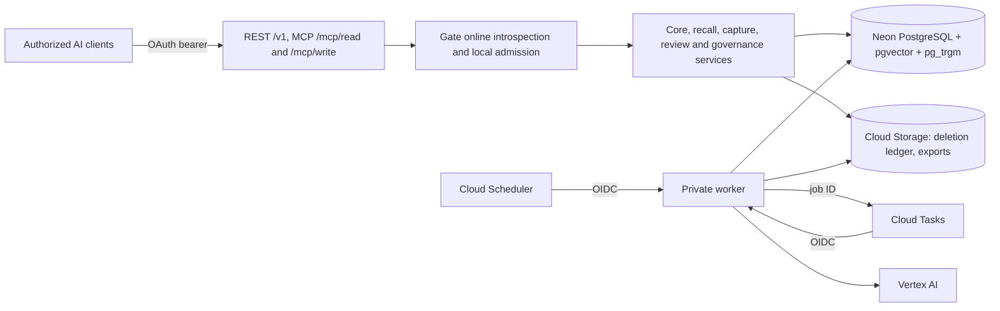

# Syntoria Lore architecture

## Service and runtime

Lore is Syntoria's independent long-term memory service for authorized AI clients. TypeScript on Node.js 24 runs as two GCP Cloud Run services built from one immutable image: an API service for REST, Remote MCP over Streamable HTTP and OpenAPI, and a private worker for capture, curation, indexing, outbox dispatch and governance maintenance. Neon PostgreSQL with pgvector and pg_trgm is the single source of truth for memories, history, relations, search indexes, jobs and the change feed. Cloud Tasks delivers job IDs to the worker and Cloud Scheduler triggers its sweep. Cloud Storage holds the deletion ledger and encrypted export artifacts. Gate owns sign-in, approvals, sessions and logout; Lore is an API-only bearer resource server, and MCP clients own their OAuth callback. The API-only source correction is pending deployment; the worker remains private. Vertex AI supplies extraction and embeddings through a provider adapter.

The Personal AI interprets intent, decides when to remember or recall and what to do with the result. Lore validates input, derives authority, curates under policy, enforces scope and source rights, preserves evidence and history, and governs Forget, retention and portability. Syntoria Weave is a separately deployed service with its own database, API, credentials, history and cursors; there are no shared tables, mutually required APIs or distributed transactions. Lore does not replicate Weave's actions; a memory that needs a Weave event as evidence references its URI or ID.

Runtime topology, identity, resources and objectives are defined in [infrastructure](docs/technical/infrastructure.md); release and recovery procedures in [deployment](docs/technical/deployment.md).

## Responsibility boundaries

| Location | Responsibility |
| --- | --- |
| apps/api/ | Node HTTP entry, REST routing, MCP read and write tool registration, OpenAPI, health and readiness |
| apps/worker/ | Private entry for task-delivered jobs and the scheduled sweep |
| packages/contracts/ | Request schemas, error codes and shared validation types |
| packages/auth/ | Gate online bearer-token verification, explicit identity binding and live grants |
| packages/domain/ | Authorized transactions, change set validation and commit, revisions, bitemporal reads, signed cursors |
| packages/connectors/ | Source registration, consent and rights, locator canonicalization and content hashing |
| packages/curator/ | Curator and embedding ports; Vertex AI, OpenAI-compatible and deterministic local adapters; proposal and evidence-anchor validation |
| packages/jobs/ | Capture job processing with checkpoints and leases, user review, outbox dispatch |
| packages/recall/ | Hybrid retrieval, relation expansion, time and rights filtering, Context Pack assembly |
| packages/governance/ | Forget and purge, deletion ledger, retention, encrypted export and import |
| packages/runtime/ | Composition helpers: storage selection, health server and product display name |
| packages/db/ | Pool, transactions, migrations and role provisioning; migrations/ holds schema, constraints, RLS and grants |
| infra/ | Cloud deployment and IAM contracts, Cloud Build and local configuration |
| scripts/, tests/ | Local stack, evaluation, load and cloud smoke tooling; unit and real-PostgreSQL suites |

API and worker share the domain packages as a modular monolith; the worker is a separately deployed entry point, not a separate business service. REST and MCP call the same services, so MCP never reimplements core rules. Model output is a proposal: it reaches the database only through change set validation, policy and revision checks. Packages, database roles and OAuth scopes use generic `memory` identifiers; the product name comes from `PRODUCT_DISPLAY_NAME`. Caller and source text is data, never policy or authorization.

## Memory contract

- M1: an observation records that something was asserted, not that it is true; an user decision is not an externally verified fact.
- M2: authority is derived from the authenticated principal, the speaker and trusted source metadata, never from model output. AI, client and connector proposals stay candidates until the user confirms them; a client cannot rewrite an user-attributed memory.
- M3: valid time and recorded time are separate. Superseding closes the earlier interval instead of deleting it; historical reads choose the revision known at `known_at`, then apply `valid_at`.
- M4: supersede, retract and forget are distinct. Contested is an epistemic flag, not a lifecycle state.
- M5: memory versions are append-only and each revision keeps its own evidence set; derived summaries and duplicates never count as independent evidence.
- M6: an episode keeps its condition, action and outcome as one experience.
- M7: reprocessing old input never reverses an explicit user decision.

The schema, relations and time model are defined in the [data model](docs/technical/data-model.md); operation semantics in the [API contract](docs/technical/mcp-api.md).

## Persistence and recovery

A commit rechecks access, source rights and expected revisions, then writes memory versions, evidence, relations, the scope offset, change log, outbox, idempotency response and audit record in one PostgreSQL transaction. Stale revisions return `revision_conflict`; identical retries replay the stored response and a changed body under the same key returns `idempotency_conflict`. Change feed sequences come from a locked per-scope offset row, so each scope's feed is gap-free in commit order; cursors are signed and bound to principal, scopes and authorization epochs. Explicit remembers are visible immediately because recall reads the source of truth, not only the search index.

Capture writes observations, a job and an outbox row atomically. The scheduled sweep dispatches job IDs to Cloud Tasks; the worker checkpoints provider output, fences writes with a lease and responds only after a durable committed, held or retry state. Delivery is at least once and idempotent; no dead-letter queue is assumed.

## Authentication and authorization

Gate issues opaque OAuth tokens for three separate resources: the REST API, `/mcp/read` and `/mcp/write`. Each resource uses its own introspection client credentials. Lore accepts bearer tokens only; it does not serve a login callback, browser session endpoint or shared-cookie authorization. The issuer, immutable Gate subject and client ID must match an operator-approved local identity binding to an existing user and principal; that binding limits scopes and capabilities, which are intersected with live grants on every operation. API and MCP operations revalidate Gate online immediately before commit. Forced row-level security with transaction-local context enforces user and scope in PostgreSQL. Runtime roles are non-superuser and `NOBYPASSRLS`. The worker accepts only IAM-authenticated OIDC calls from the dedicated task and scheduler identities. Logs carry identifiers, statuses and durations, never memory content, evidence or credentials. Trust boundaries and remaining limits are in [security](docs/technical/security.md).

The original Gate production rollout is preserved in the [2026-10-18 release record](docs/eval/gate-production-release-20261018.md). The current API-only source candidate and its operational checklist are in the [2026-10-19 correction record](docs/eval/api-only-gate-auth-correction-20261019.md); positive hosted MCP data acceptance remains unverified.

## Forget and restore

Forget commits suppression and content-free tombstones in one transaction, appends the deletion instruction to an independent ledger in Cloud Storage, and purges content asynchronously. Readiness compares the database checkpoint with the ledger head: protected reads fail closed until a restored database has replayed every newer deletion. Source-rights revocation is separate from Forget and invalidates earlier exports in the scope.

## Verification

Pure and adapter-level unit tests, a required real-PostgreSQL integration suite, restore and portability scripts, a local Compose acceptance run with a deterministic 231-case evaluation, and cloud smoke harnesses each establish a different boundary; a lower-fidelity pass never closes a higher one. See [testing](docs/technical/testing.md). Current evidence is in [local acceptance](docs/eval/local-acceptance.md) and the [cloud verification register](docs/eval/cloud-verification.md). Architectural decisions do not establish deployed behavior.
