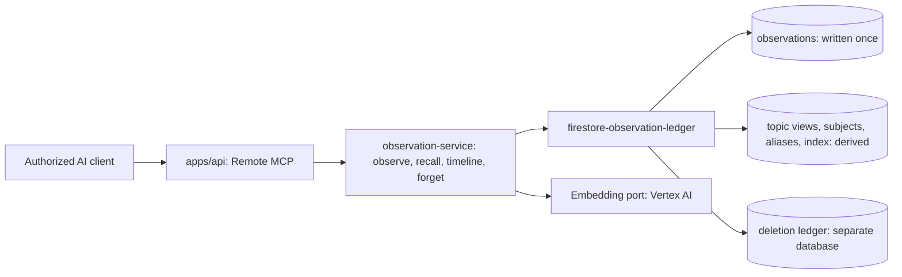

# Syntoria Lore architecture

## Access authentication

Access mode is enabled by `ACCESS_ISSUER`, `ACCESS_AUDIENCE` and
`ACCESS_OWNER_EMAIL`. The API independently verifies the RS256 assertion from
`Cf-Access-Jwt-Assertion`: fixed issuer, exact application audience, expiry,
issued-at, nonempty subject and owner email. Gateway user-info headers and the
backend IAM `Authorization` header do not establish application identity.

`OWNER_ADMISSION_ISSUER` and `OWNER_ADMISSION_SUBJECT` select an existing admission.
These are persistence coordinates, never claims copied from an Access token. The
API reads that admission without rewriting its tenant, scope, policy or historical
records. All admitted AI connections use one `shared-ai` actor. The stored
`connectionId` and `gateClientId` fields retain their existing schema names but
contain that shared group, rather than an individual AI identity. New shared
permissions start with General only; existing grants are never unioned. Policy
approval remains separate from AI proposal authority.

Deploy behind an API Gateway that verifies the same Access JWT and invokes Cloud
Run with a dedicated service account. Accept the backend hostname explicitly in
`MCP_ALLOWED_HOSTS`; do not trust request-supplied forwarded hosts. Access owns MCP
OAuth discovery in this mode, so the API does not advertise legacy Gate metadata.
The old Gate configuration remains available for rollback and isolated regression
fixtures; Access mode does not instantiate or call its verifier.

## Current state

Lore keeps a ledger of observations on Firestore, as [ADR 0010](docs/adr/0010-record-observations-and-derive-the-current-state.md) decides and the [observation ledger design](docs/design/observation-ledger.md) specifies. An AI writes an observation once; Lore never rewrites it and derives from the observations of a topic what is current, what it was before and when it changed. `apps/api` serves this over Remote MCP.

The Memory Records model of [ADR 0007](docs/adr/0007-store-memories-as-firestore-memory-records.md) that preceded it is no longer served. Its repository, value model and recall code remain in `packages/memory-records` because the ledger extends the repository and converts the records it holds; its collections are read only by that conversion. The PostgreSQL implementation before it was removed on 2026-11-09 and remains in Git history; pages that describe it are marked historical.

The ledger and the service were verified against the Firestore emulator with a fake Gate and deterministic embeddings. What was observed on the hosted service is in the dated [evaluation records](docs/eval/); nothing here claims hosted behaviour.

## Model

An observation states something about named subjects: a `state` that holds until it changes, or an `event` that happened. One aspect of one subject is a topic; its state observations, in time order, are its course. The view of a topic, the subject and alias tables and the search index are derived and can be rebuilt. Originals in other services are referenced by their own identifiers and never copied.

## Component ownership

| Area | Responsibility |
| --- | --- |
| `packages/memory-records/src/observations.ts` | The observation value model as pure functions: validation, tiers, and the course and view of a topic, which depend only on the set of observations and not on their order of arrival |
| `packages/memory-records/src/firestore-observation-ledger.ts` | The ledger on Firestore, a subclass of the repository: the write transaction (observation, subjects and aliases, topic view, change-feed entry), reads by subject, topic and time, bounded term and vector queries, links, source reports, writer suppression, Forget and purge of observations, and conversion of Memory Records |
| `packages/memory-records/src/observation-service.ts` | The operations adapters call: observe, recall, timeline, read, link, source report, Forget and change feed. Assembles recall from named subjects, term hits and vector hits, and after each write purges recorded Forgets, converts old records and indexes waiting observations without failing the write |
| `packages/memory-records/src/search-terms.ts` | Term derivation by script, name candidates of a query, selection of lookup terms and rarity-weighted term coverage |
| `packages/memory-records/src/firestore-repository.ts` | The Memory Records repository the ledger extends: authorization checks, idempotent request pins, per-scope sequence, change feed with signed cursors, Forget, purge, restore checkpoint. Its record commits and recall are no longer reachable from the service |
| `packages/memory-records/src/index.ts`, `derived-recall.ts`, `service.ts`, `capture.ts` | The Memory Records value model, recall, service and capture, kept for the conversion and for tests; not served |
| `packages/memory-records/src/access.ts` | Reads admissions (`memoryAdmissions`, keyed by a digest of Gate issuer and subject), creates a missing connection, person or worker authorization with an empty allowance and never widens one, and is the only code that mints a verified actor capability. Applies the admission's approval policy: `automatic` records a `policy` approval for the exact request digest; any other policy returns `user_required` |
| `packages/memory-records/src/firestore-deletion-ledger.ts` | The deletion ledger on its own Firestore database: append-only entries and a head that moves in the same transaction |
| `packages/memory-records/src/firestore-client.ts`, `runtime.ts` | Firestore client construction (Application Default Credentials, or a loopback emulator) and wiring of the two databases |
| `apps/api` | Node.js 24 HTTP service: `/healthz`, `/readyz` (both databases answer), protected-resource metadata, and stateless Streamable HTTP MCP at `POST /mcp` with Gate introspection for exactly `MCP_RESOURCE_URL`, admission (403 without one), body and rate limits, and the Vertex AI embedding provider. Configuration is environment-only and fails fast |
| `scripts/admit-subject.mjs` | Operator tool that creates or reactivates one admission with the `automatic` policy; it refuses to move an existing admission to another tenant or scope |
| `scripts/migrate-source-metadata.mjs` | Private, reviewed operator path for appending evidenced source metadata; its audit uses the credential-derived IAM identity and it is not exported through the API, service or runtime |

Each admitted connection writes as its own principal, set by the server. The tier of an observation is derived from the write path: `person` when the approval policy grants the person's authority to a write that asks for it, `source` when it cites an original outside Lore, otherwise `inference`. Nothing waits for approval.

Not built: the REST adapter, the private worker (indexing, purge, conversion and restore reconciliation run in the API process after a write), person confirmation at Gate, a reviewed way to widen compartment allowances or revoke sources, an operator tool for writer suppression, and tracked deployment configuration.

## Correctness boundaries

- **An observation is written once.** A change is a new observation. The only later write to an observation is the mark that it was forgotten.
- **The present is derived, and the derivation is deterministic.** A topic's view is computed from its observations by rule, without a model, and gives the same result whatever the order of arrival. A rebuild must reproduce the stored view.
- **Authority comes from the verified actor.** Writer and tier are set from the actor and the write path; a request field cannot set them. A lower tier does not replace or retract a state of a higher tier; the disagreement stays visible as an open conflict.
- **Reads are bounded.** Every read is by key or a bounded query. Subjects are found through the alias table, topics by subject, and term and vector search return a bounded number of candidates; a term query that reaches its bound says that results are partial.
- **Rights apply at read time.** Allowance, source rights, suppression and writer suppression are checked on every observation before it is returned, including those a stored view names; when a reader may not see everything that went into a view, the view is computed from what that reader may see. Firestore server clients bypass Security Rules, and a lint rule confines the Firestore client to the repository, the ledger, the client factory, the deletion ledger and the access module; there is no database-level backstop.
- **Forget denies first, purges later.** A Forget reports use stopped only after the independent ledger append is durable. Purge removes the observation, its index entry and its source reports and rebuilds the topic view. After a restore, a suppression named by the ledger hides an observation even when the restored document lacks its forgotten mark.
- **Sources are references.** Lore stores identifiers, a link, the version seen and when it was read. It never fetches a source, so it reports what readers found, not whether a source is unchanged.
- **Search is built in Lore.** Terms are derived by script; name and term matching and ranking run in the service over bounded candidates. Firestore Standard has no full-text search, and its vector index is flat; [ADR 0010](docs/adr/0010-record-observations-and-derive-the-current-state.md) accepts those limits.

## Runtime boundary

Provisioned on 2026-11-09: Memory Records live in a dedicated Firestore Native database, `lore-memory-records`, and the deletion ledger in a second one, `lore-deletion-ledger`, in the shared Syntoria GCP project in `asia-southeast1`; an IAM condition limits the API service account to those two databases. The API runs on Cloud Run as `lore-api`, a private worker will follow, following the Cloud Run parts of [ADR 0001](docs/adr/0001-gcp-cloud-run-neon.md). Gate owns sign-in, approvals and sessions. Production identifiers stay out of the repository.

Syntoria Weave is a separate service for current shared state. Lore has no shared storage or required API dependency on Weave.

## Verification boundary

Unit tests check the value models, the service configuration and Gate token verification. The emulator suite checks the ledger through a real MCP client against a fake Gate, and the Memory Records repository it extends. The emulator does not enforce composite or vector indexes and does not show managed IAM, transaction contention, latency, cost, managed restore or search quality; deterministic embedding doubles do not measure recall quality. The indexes the queries need are declared in [firestore.indexes.json](firestore.indexes.json). The [development guide](docs/development.md) lists the commands, and dated results live in [evaluation records](docs/eval/).
