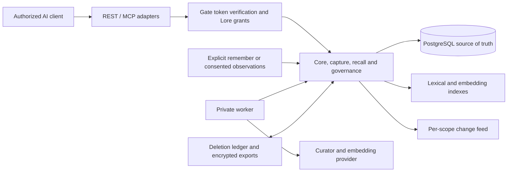

# Syntoria Lore architecture

## Developer model

Lore turns authorized input into versioned, evidence-linked memories and returns a bounded selection to an authorized client. REST and Remote MCP are adapters over the same services. PostgreSQL is the source of truth; embeddings, lexical search support and relations help find candidates but do not replace committed records.

The [memory-system reference](docs/technical/memory-system.md) follows explicit writes and source capture through curation, indexing, retrieval, correction and Forget. The [data model](docs/technical/data-model.md) defines persistence and transaction rules; the [MCP/API contract](docs/technical/mcp-api.md) defines client operations.

## Component ownership

| Area | Responsibility |
| --- | --- |
| `apps/api/` | REST routing, MCP tool adapters, OpenAPI and API health |
| `apps/worker/` | Task-delivered capture and governance work, indexing repair and scheduled recovery |
| `packages/contracts/` | Request schemas and public error vocabulary |
| `packages/auth/` | Gate bearer verification, identity binding and grant checks |
| `packages/domain/` | Authorized transactions, ChangeSet validation and commit, revisions and historical reads |
| `packages/connectors/` | Consent, source rights, observation acceptance and source lineage |
| `packages/curator/` | Extraction and embedding provider interfaces, structured proposal validation |
| `packages/jobs/` | Capture jobs, evidence-anchor checks, review routing and outbox work |
| `packages/recall/` | Candidate search, ranking, relation expansion and Context Pack assembly |
| `packages/governance/` | Forget, deletion ledger, retention and encrypted portability |
| `packages/db/` | PostgreSQL pools, migrations, roles and database setup |

REST and MCP call these same packages; adapters do not implement separate memory policy. The worker is another entry point to the same domain and database contracts, not a second memory store.

## Main data flow

An explicit remember uses the synchronous core path. A source capture is different: Lore accepts observations only after that source has been enabled with consent, then stores the capture job and work notification with the source data. A worker claims the job, calls the curator outside the commit transaction, validates the returned proposal and its exact evidence anchors, reconciles it with existing memories, and either commits an allowed fact or creates a user review. Lore accepts observations from clients; it does not itself synchronize arbitrary AI histories or fetch documents from other services.

A committed memory version, its evidence links, relations, change-feed event, outbox record and idempotency response are written atomically after authorization, source-rights and expected-revision checks. Recorded time is separate from valid time. The change feed has its own per-scope ordering so clients can catch up independently of search indexes.

Recall first checks the actor and requested scopes, then selects eligible records under current source rights, Forget suppressions, lifecycle and time. Precise mode uses exact text and subject/alias matches. Contextual, historical and exploratory modes combine bounded exact, lexical and semantic candidate lists, then can expand relations from supported roots. Changes mode follows a separate change-oriented candidate path; `get_changes` supplies the ordered feed. Ranking and Context Pack limits are implementation bounds; they do not promise complete recall. See [retrieval behavior and limits](docs/technical/memory-system.md#retrieval-and-context-packs).

## Correctness boundaries

- **Provenance and authority are separate.** Evidence identifies the source, speaker and lineage. Authority comes from the authenticated principal's actor kind, the memory kind, the declared epistemic status and the controlled user-confirmation path. Requests and model output cannot assign authority, and stored authority does not prove an external claim. Because admission is keyed by Gate issuer and subject, every client of one Gate account shares its principal; a client acting as the user marks its own suggestions `proposed` to keep them as AI proposals.
- **Time and knowledge are separate.** A revision records when it was learned; valid-time intervals record when it applies. Historical reads choose the latest revision known at the requested time before applying its valid interval.
- **Changes are explicit.** ChangeSets compare expected revisions. A stale update fails instead of overwriting concurrent work. Supersede, retract and Forget have different semantics; contested is an epistemic flag, not a lifecycle state.
- **Search is derived data.** Indexing can lag a committed revision. Recall reads committed records as well as the available indexes and reports index or provider insufficiency; an index result is never the authority for what was committed.
- **Rights apply at read time.** Scope grants, source consent and source rights are checked for candidates and again before returning them. PostgreSQL row-level security enforces the tenant boundary inside transactions.
- **Forget denies first, purges later.** Suppression and a content-free deletion event are committed before asynchronous purge. A restore cannot serve protected data until the independent deletion ledger and database checkpoint agree.

## Identity and runtime boundary

Gate owns sign-in, approval and sessions. Lore accepts bearer tokens for the exact REST, MCP read or MCP write resource and has no browser login or session route. The API has a public HTTPS entry point but protected data operations require Gate verification, an existing Lore identity binding for the Gate issuer and immutable subject, and live grants. MCP clients register dynamically with Gate; the binding does not distinguish them, so clients under one subject differ only in the resource they use. The worker remains private and accepts only its task and scheduler identities. Runtime topology, IAM and operator procedures belong in [infrastructure](docs/technical/infrastructure.md), [security](docs/technical/security.md) and [deployment](docs/technical/deployment.md).

Syntoria Weave is a separate service for current shared state. Lore has no shared tables or required API dependency on Weave; a caller that needs both composes their results.

## Verification boundary

Unit tests, real-PostgreSQL contract tests, local acceptance, and hosted checks answer different questions. Passing a local deterministic provider does not measure extraction quality or semantic recall quality. The [development guide](docs/development.md) lists the verification commands, and dated results live in [evaluation records](docs/eval/).
