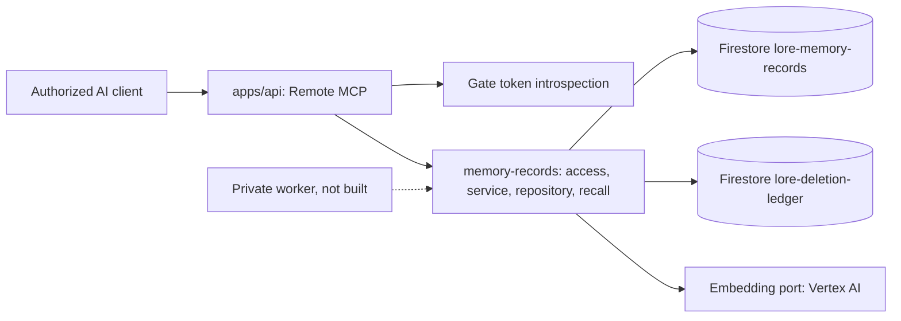

# Syntoria Lore architecture

## Access authentication

Access mode is enabled by `ACCESS_ISSUER`, `ACCESS_AUDIENCE` and
`ACCESS_OWNER_EMAIL`. The API independently verifies the RS256 assertion from
`Cf-Access-Jwt-Assertion`: fixed issuer, exact application audience, expiry,
issued-at, nonempty subject and owner email. Gateway user-info headers and the
backend IAM `Authorization` header do not establish application identity.

`OWNER_ADMISSION_ISSUER` and `OWNER_ADMISSION_SUBJECT` select an existing admission.
These are persistence coordinates, never claims copied from an Access token. The
API reads that admission without rewriting its tenant, scope, policy or historical
records. All admitted AI connections use one `shared-ai` actor. The stored
`connectionId` and `gateClientId` fields retain their existing schema names but
contain that shared group, rather than an individual AI identity. New shared
permissions start with General only; existing grants are never unioned. Policy
approval remains separate from AI proposal authority.

Deploy behind an API Gateway that verifies the same Access JWT and invokes Cloud
Run with a dedicated service account. Accept the backend hostname explicitly in
`MCP_ALLOWED_HOSTS`; do not trust request-supplied forwarded hosts. Access owns MCP
OAuth discovery in this mode, so the API does not advertise legacy Gate metadata.
The old Gate configuration remains available for rollback and isolated regression
fixtures; Access mode does not instantiate or call its verifier.

## Current state

On 2026-11-09 the owner deleted the PostgreSQL deployment, and the PostgreSQL implementation (the REST and MCP API, the worker and their packages) was removed from the repository. Lore is being rebuilt on Firestore Memory Records, as [ADR 0007](docs/adr/0007-store-memories-as-firestore-memory-records.md) and [ADR 0008](docs/adr/0008-keep-a-generative-baseline-and-enable-decision-models-per-point.md) decide and the [Memory Records design](docs/design/memory-records.md) specifies.

The repository holds `packages/memory-records`, verified against the Firestore emulator ([local record](docs/eval/memory-records-s2-local-20261109.md)), and `apps/api`, the first Firestore service: a Node.js HTTP server with Remote MCP over that package. The service was tested against the emulator with a fake Gate and deterministic embeddings, and deployed to Cloud Run on 2026-11-09; in production only readiness and the authentication boundary have been checked ([release record](docs/eval/memory-records-firestore-release-20261109.md)). Proposal recall and structured MCP source references in the current repository have not been verified against the hosted deployment. The removed implementation remains in Git history; pages that describe it are marked historical.

## Target model

Lore turns authorized input into versioned, source-referenced Memory Records and returns a bounded selection to an authorized client. REST and Remote MCP will be adapters over the same domain package. Firestore is the source of truth; term and embedding entries derived from each revision help find candidates but never replace committed records.

## Component ownership

| Area | Responsibility |
| --- | --- |
| `packages/memory-records/src/index.ts` | Memory Record value model, validation, and lifecycle, approval and time selectors |
| `packages/memory-records/src/firestore-repository.ts` | The only module allowed to use the Firestore client: transactional commits, idempotency, per-scope sequence and signed cursors, history reads, write authorization against the stored record, Forget, purge, restore checkpoint and source rights |
| `packages/memory-records/src/capture.ts` | Baseline A capture through extractor and source-fetcher ports, durable capture jobs and held results |
| `packages/memory-records/src/derived-recall.ts` | Revision-fenced term and embedding entries, candidate recall with an overlay for unindexed changes, and a byte-bounded Context Pack |
| `packages/memory-records/src/search-terms.ts` | Term derivation by script (Japanese character bigrams, one term per other run of letters and digits), the searchable text of a record, and rarity-weighted term coverage |
| `packages/memory-records/src/access.ts` | Reads admissions (`memoryAdmissions`, keyed by a digest of Gate issuer and subject), creates a missing connection, person or worker authorization with an empty allowance and never widens one, and is the only code that mints a verified actor capability. Applies the admission's approval policy: `automatic` records a `policy` approval for the exact request digest; any other policy returns `user_required` |
| `packages/memory-records/src/service.ts` | The operations adapters call: remember, refine, supersede, retract, Forget, recall, history and change feed. Builds records from trusted metadata only, pins each idempotent request's recorded time so retries replay, includes proposals in recall by default with an explicit opt-out, reconciles a scope whose restore checkpoint lags the ledger before use, and after each write purges recorded Forgets and indexes a bounded batch without failing the write |
| `packages/memory-records/src/firestore-deletion-ledger.ts` | The deletion ledger on its own Firestore database: append-only entries and a head that moves in the same transaction |
| `packages/memory-records/src/firestore-client.ts`, `runtime.ts` | Firestore client construction (Application Default Credentials, or a loopback emulator) and wiring of the two databases |
| `apps/api` | Node.js 24 HTTP service: `/healthz`, `/readyz` (both databases answer), protected-resource metadata, and stateless Streamable HTTP MCP at `POST /mcp` with Gate introspection for exactly `MCP_RESOURCE_URL`, admission (403 without one), body and rate limits, and the Vertex AI embedding provider. Configuration is environment-only and fails fast |
| `scripts/admit-subject.mjs` | Operator tool that creates or reactivates one admission with the `automatic` policy; it refuses to move an existing admission to another tenant or scope |
| `scripts/migrate-source-metadata.mjs` | Private, reviewed operator path for appending evidenced source metadata; its audit uses the credential-derived IAM identity and it is not exported through the API, service or runtime |

Each Gate connection is its own principal with its own authorization. The person's authority acting through a connection is a separate person principal per connection, because an authorization document binds one connection. Recall includes matching records with derived proposal authority by default, including candidates, and returns their lifecycle and writer attribution; `include_proposals=false` limits results to user authority. Equal-relevance user-authority records rank first. `as_user` asks for the person's authority, which only the approval policy grants. Proposal recall does not approve a record or change its identity.

MCP remember and correction inputs can attach up to ten declared HTTPS source references. Provider, URI, optional title, locator and version are stored with the revision; `confidential` is a source metadata marker, not an access grant or a new ACL. Lore does not fetch these URIs. Recall and `get_memory` return stored references, while repository source revocation, compartment allowances and Forget remain enforced at read time.

Not built yet: the REST adapter, the private worker (indexing, purge and restore reconciliation run in the API process), person confirmation at Gate, a reviewed way to widen compartment allowances or revoke sources, real extractor and source providers, and tracked deployment configuration (the first release was deployed with operator scripts kept outside the repository).

## Correctness boundaries

These hold in the package today and are contracts for the service built on it:

- **Authority comes from the verified actor.** Writes take a verified actor capability and are authorized against the stored record, not the submitted one. Labels, attribution and authority come from trusted source metadata and the approval path; model output never sets them. A proposal is never a decision.
- **Time and knowledge are separate.** Each revision records when it was known; valid time records when it applies. Historical reads select them independently.
- **Changes are explicit.** Commits check expected revisions, so a stale update fails instead of overwriting. Supersede, retract and Forget stay distinct.
- **Search is derived data.** Index entries are fenced to a revision, unindexed changes are overlaid, and every candidate is rechecked against the committed record before it is returned. Names and terms are matched against that committed record: a subject or alias the query mentions, then the rarity-weighted share of the query's terms, then vector similarity. Each result lists what matched, and `semantic-match-only` marks a result set that no name or term supports ([ADR 0009](docs/adr/0009-keep-firestore-and-repair-in-process-term-matching.md)). A current index holds one entry per record for its head revision; once it covers a scope, a question about the present ranks from it, kept in process memory while the index watermark is unchanged, and reads only the best candidates' records. It is read whole, up to 5,000 records per scope. A question about the past, and a scope not yet covered, read the per-revision index, at most 1,000 entries in no defined order. Past either number the scope is searched only in part and the result says so. Vector similarity is computed in memory; this is not Firestore vector search.
- **Rights apply at read time.** Compartment allowances and source rights are checked in the repository boundary. Firestore server clients bypass Security Rules, so a lint rule confines the Firestore client to the repository, client, deletion-ledger and access modules, and the access contract and its tests are the only protection; there is no database-level backstop like the former row-level security.
- **Forget denies first, purges later.** A Forget reports use stopped only after the independent ledger append is durable. Reads stay closed after a restore until the restore checkpoint is reconciled; the service reconciles a lagging scope before its next operation and fails the operation when the ledger cannot be read.
- **Source metadata maintenance is source-only.** The private operator path appends a new revision while preserving the original assertion writer, approval, content and existing source references. Its audit identifies the metadata editor separately; prior revisions and indexes are never rewritten, and no public API grants this authority.

## Runtime boundary

Provisioned on 2026-11-09: Memory Records live in a dedicated Firestore Native database, `lore-memory-records`, and the deletion ledger in a second one, `lore-deletion-ledger`, in the shared Syntoria GCP project in `asia-southeast1`; an IAM condition limits the API service account to those two databases. The API runs on Cloud Run as `lore-api`, a private worker will follow, following the Cloud Run parts of [ADR 0001](docs/adr/0001-gcp-cloud-run-neon.md). Gate owns sign-in, approvals and sessions. Production identifiers stay out of the repository.

Syntoria Weave is a separate service for current shared state. Lore has no shared storage or required API dependency on Weave.

## Verification boundary

Unit tests check the value model, the service configuration and Gate token verification; the emulator suite checks the repository, capture and recall, and drives the API through a real MCP client against a fake Gate. The emulator does not show managed IAM, transaction contention, latency, cost, managed restore or search quality, and deterministic extractor and embedding doubles do not measure extraction or recall quality. The [development guide](docs/development.md) lists the commands, and dated results live in [evaluation records](docs/eval/).
