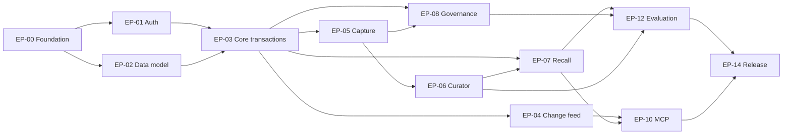

# Syntoria Lore development plan (historical)

> Historical plan, written when the service was named Thymesis: sections below are dated implementation and acceptance snapshots, not a current deployment report. Section 0.3 preserves the 2026-10-17 pre-Gate evidence. As of 2026-10-19, the API-only authentication correction is deployed: the API is reachable over public HTTPS, protected operations require a Gate bearer token, and the worker remains private. Gate dynamic client registration and Lore subject admission were released on 2026-10-20. Positive hosted MCP memory retrieval with a real user remains unverified, and operational Release 1 acceptance is still open. Current contracts and gates are in [deployment](technical/deployment.md), [identity cutover](technical/identity-cutover.md), the [API-only correction record](eval/api-only-gate-auth-correction-20261019.md) and the [DCR production release record](eval/dcr-production-release-20261020.md).

- Version: 1.0
- Date: 2026-10-14
- Status: **The sections below preserve dated local and hosted evidence. The API-only Gate authentication correction was deployed on 2026-10-19, followed by the DCR release on 2026-10-20 and change confirmations on 2026-10-29; positive hosted MCP memory retrieval with a real user and operational Release 1 acceptance remain unverified. See the current [deployment gates](technical/deployment.md) before making hosted claims.**
- Infrastructure baseline: GCP Cloud Run / Cloud Tasks / Cloud Scheduler + Neon PostgreSQL
- Architecture decision: [ADR-0001](adr/0001-gcp-cloud-run-neon.md)
- Product requirements: [design/requirements.md](design/requirements.md)
- Architecture: [../ARCHITECTURE.md](../ARCHITECTURE.md)

## 0. Delivery outcome and rule

**Goal:** Put the independent long-term memory service (then named Thymesis, now Syntoria Lore) into real use by Personal AI. Implement the whole path consistently: capture of conversations, documents and experience, automatic organization, evidence-backed recall, correction, change retrieval, Forget and recovery.

**Not a technology evaluation project.** Adopt **GCP Cloud Run + Cloud Tasks + Cloud Scheduler + Neon PostgreSQL (pgvector/pg_trgm)** as the baseline and complete an end-to-end path that delivers usable value at each stage. Do not present unimplemented parts as "done". [ADR-0001](adr/0001-gcp-cloud-run-neon.md) is the authority for the infrastructure choice; do not repeat comparison PoCs indefinitely.

Release 1 is done when **every FR and AC-01–13 in [design/requirements.md](design/requirements.md) is achieved**. Do not call Phase 1 completion product completion. During design, turn decided contracts into OpenAPI, DDL and tests, and require an evidence-backed ADR for changes.

## 0.1 Current local implementation snapshot (2026-10-14)

[Product requirements](design/requirements.md) and [ARCHITECTURE.md](../ARCHITECTURE.md) remain the adopted requirements and architecture baselines. This repository now has executable local evidence across core transactions, Capture/Curator/Recall, Forget/portability/MCP, restore reconciliation, Compose operations, CI configuration, and the final acceptance suite. The [local acceptance record](eval/local-acceptance.md) is the current source for observed commands, counts, results and limitations; earlier component reports remain dated milestone evidence.

| Area                            | Implemented and observed locally                                                                                                                                                                                                                                                | Boundary                                                                                                            |
| ------------------------------- | ------------------------------------------------------------------------------------------------------------------------------------------------------------------------------------------------------------------------------------------------------------------------------- | ------------------------------------------------------------------------------------------------------------------- |
| Local runtime                   | Pinned PostgreSQL/pgvector and Node base images; loopback Compose API, separate private worker, Gate tokens supplied by an operator, fake Tasks/Scheduler/providers, migrations, readiness and diagnostics. Non-root runtime image is checked by CI configuration and built locally. | Local adapters and generated infrastructure secrets only.                                                                 |
| Core and Recall                 | Real PostgreSQL authorization/RLS, Remember, all ChangeOps, CAS, two-time Get, change feed, hybrid modes, evidence rights and bounded context packing.                                                                                                                          | Exact vector search and deterministic local embedding/curator do not establish paid-model quality or scale.         |
| Capture and review              | Actual REST→durable job→worker→Recall path, idempotent retry, safe auto-commit, held review and explicit User decisions.                                                                                                                                                       | Local fake providers; cloud identity/provider adapters are excluded.                                                |
| Governance and interoperability | Immediate Forget suppression, physical purge, source-rights revocation, encrypted history export/import, canonical OAuth resources for two MCP clients, and separate snapshot restore with executable ledger reconciliation.                                                    | Filesystem artifact/ledger adapters do not establish hosted storage durability or RPO/RTO.                          |
| Acceptance and operations       | Required PostgreSQL suite, deterministic 231-case evaluation, local OAuth/MCP smoke, configurable mixed-load smoke, diagnostics and recovery/runbooks are reproducible through the local acceptance command.                                                                    | No hosted CI run, cloud deployment, production cost/latency, paid model, external audit, or 100k–5m capacity claim. |

Forward migrations add pgvector and governance schema without editing applied migration checksums. Local Recall uses exact search; no approximate-index performance claim is made.

## 0.2 Authorized-scope task status register

Every one of the 106 task IDs in this plan is listed exactly once. `implemented-local` means its local contract portion has executable evidence; `cloud-excluded` means the task's hosted, paid-provider, scale, or cloud-operations acceptance was outside the authorized test-environment scope. No local acceptance requirement remains unresolved. T-146's report and digests are complete locally; commit/signing/publication were not requested or performed.

| Status            | Task IDs                                                                                                                                                                                                       | Qualification                                                                                                                                                                                                         |
| ----------------- | -------------------------------------------------------------------------------------------------------------------------------------------------------------------------------------------------------------- | --------------------------------------------------------------------------------------------------------------------------------------------------------------------------------------------------------------------- |
| implemented-local | T-001–003, T-005–007, T-011–015, T-020–025, T-030–036, T-040–043, T-045–046, T-050–052, T-054–056, T-061–068, T-070–077, T-080–086, T-090–094, T-100–104, T-110–114, T-120–126, T-131, T-133, T-141–144, T-146 | Local portions are mapped to automated checks in the acceptance report; T-146 includes the report and source/config/fixture digests. This status does not imply the G4 production gate.                               |
| cloud-excluded    | T-004, T-008–010, T-026–027, T-044, T-053, T-060, T-115, T-130, T-132, T-134–137, T-140, T-145                                                                                                                 | Hosted deployment/identity/queue/provider, Neon operations, large-scale or production cost/alerting/soak evidence is not claimed. Local adapters and a small parameterized load harness are documented where present. |

All local implementation and acceptance work authorized here is complete; the rows above preserve hosted and explicitly excluded task acceptance boundaries rather than marking them green. Commit/signing/publication were not requested or performed.

## 0.3 Historical hosted verification register (2026-10-17 UTC)

Section 0.2 is the dated local-scope register. This section preserves the hosted evidence snapshot as of 2026-10-17; it does not describe the later Gate cutover or current HTTPS/API state. See the [2026-10-18 production release record](eval/gate-production-release-20261018.md) and [2026-10-19 API-only correction record](eval/api-only-gate-auth-correction-20261019.md) for current hosted facts and remaining gates.

| Task IDs                                  | Hosted status as of 2026-10-17                                                                                                                                                                                                                                                                                    |
| ----------------------------------------- | ------------------------------------------------------------------------------------------------------------------------------------------------------------------------------------------------------------------------------------------------------------------------------------------------------------------ |
| T-004, T-008                              | Final 178-file sanitized source manifest built successfully in Cloud Build `8abf1d4d-eacc-47e5-844d-6645a7d8a877`; image `sha256:96a4704f5ab3a413470cd2fe4833ca4009df5578be0bd20a496ee0a6ca44d65e` is deployed to API revision `thymesis-api-00002-hsx` and worker revision `thymesis-worker-00002-hg8`. The full Compose/integration suite was not rerun after the packaging-only adjustment. |
| T-009                                     | IAM readback and two Scheduler `jobs.run` dispatches passed. A synthetic Cloud Tasks capture reached terminal `held`, and two completed authenticated worker sweeps preserved that state. This verifies the observed delivery path, not transient-failure recovery or auto-commit. |
| T-010                                     | Historical: the approved public invoker grant targeted the former identity service. Discovery/JWKS and REST/MCP checks passed at that time. No public Cloud Run invoker was added for the Gate cutover. |
| T-080–083, T-091–093                       | Historical hosted governance run passed cross-user encrypted Import/Recall, immediate Forget suppression, purge, and artifact removal in 33.183s. Former Keycloak test-user/client state is not active Gate configuration. Each rerun needs a fresh disposable destination. |
| T-044, T-053                              | A synthetic Cloud Tasks capture reached `held` after delivery and two direct authenticated worker sweeps left it held. The earlier stale-authorization job is also held; hosted transient-failure recovery and extraction/auto-commit remain unverified. |
| T-060                                     | Worker ADC reached the configured Vertex models. Extraction quality, latency/cost acceptance, and production provider behavior remain unverified.                                                                                                                                                                  |
| T-113                                     | Local restore replay and isolated local-PostgreSQL + real-GCS clone replay passed (one entry replayed and purged; readiness opened afterward). Managed Neon PITR and RPO/RTO remain unverified.                                                                                                                    |
| T-132                                     | The isolated restore harness does not prove managed Neon PITR, RPO, or RTO. Those rehearsals remain unverified.                                                                                                                                                                                                    |
| T-130, T-134–137, T-140, T-142–143, T-145 | Dashboards, cost, alerting, load/soak, staged production acceptance, security/privacy acceptance, and rollback rehearsal remain unverified.                                                                                                                                                                        |
| T-133, T-144, T-146                       | This section and report preserve the 2026-10-17 evidence snapshot. [Deployment](technical/deployment.md) and the [infrastructure runbook](technical/infrastructure-runbook.md) document current procedures; documentation is not runtime acceptance evidence. |

At the time of this 2026-10-17 record, the former identity service had an approved public invocation route; discovery/JWKS, REST/MCP OAuth and the hosted governance run passed. Those Keycloak findings are historical and do not establish current Gate configuration. The API and worker remain IAM-private; this cutover adds no public API invoker. No hosted Gate deployment, resource registration, identity mapping or migration 0042 application is claimed. Managed Neon PITR/RPO/RTO, production load/SLO/cost/soak and broader security/privacy release acceptance remain open. Do not report full cloud acceptance or production readiness.

## 1. Workstreams, prerequisites and milestones

### Milestone gates (delivery order)

| Gate                         | Outcome                                                                     | Blocking acceptance                                                 |
| ---------------------------- | --------------------------------------------------------------------------- | ------------------------------------------------------------------- |
| **G0 Contract & skeleton**   | Reproducible development environment, OpenAPI, DDL and authentication-boundary test scaffolds | lint/typecheck/test/migration/CI pass                               |
| **G1 Reliable memory core**  | Sync Remember/Recall, Evidence, Version, authorization, change feed         | Regression tests for time, provenance, Scope, conflicts and Cursor  |
| **G2 Automatic operation**   | Capture→Curator→ChangeSet→Commit, Queue, Hybrid Recall                      | E2E for automatic capture, duplicates, contradictions and failure recovery |
| **G3 Governance complete**   | Forget, Source ACL, Export/Import, MCP, periodic reassessment                | Zero unauthorized access and zero forgotten-content resurrection; use from other AIs |
| **G4 Production acceptance** | Quality, performance, cost, operational monitoring, backup and release      | Quality targets in design/requirements.md and runbook verification  |

Milestones are **acceptance gates in dependency order, not MVP cuts for dropping functionality**.

### Epic dependency diagram



## 2. Concrete repository layout

```text
thymesis/
  README.md
  PRODUCT.md
  ARCHITECTURE.md
  docs/
    DEVELOPMENT_PLAN.md
    development.md     # development and acceptance entry point
    api/openapi.json   # generated REST contract
    design/            # product positioning, requirements (FR/AC, service targets)
    technical/         # data model, API, infrastructure, security, testing, deployment, runbooks
    usage/             # use cases, sign-in, agent workflows
    templates/         # migration review, recovery rehearsal
    adr/
    eval/              # dated verification records
  apps/
    api/               # REST & MCP read/write entrypoints
    worker/            # private Cloud Run Tasks consumer / scheduler handlers
  packages/
    contracts/         # schemas, error codes, generated types
    domain/            # policy, memory semantics, ChangeSet
    db/                # schema/migrations/query repository/RLS
    curator/           # extraction / consolidation / provider adapter
    recall/            # hybrid retrieval + context pack
    connectors/        # optional, permissioned sources
    observability/
  infra/               # Terraform or declarative GCP/Neon, IAM, secrets/config templates
  tests/
    unit/
    integration/
    e2e/
    security/
    evaluation/
    load/
```

Technology guidelines:

- TypeScript strict mode, monorepo package workspaces, Vitest, ESLint and a formatter, OpenAPI type generation, and strict validation such as JSON Schema or Zod.
- Use typed queries and migrations such as Drizzle as the baseline, alongside reviewable explicit SQL for pgvector, pg_trgm and RLS. Parameterize every dynamic value.
- Local PostgreSQL (Docker), a Node.js HTTP server equivalent to Cloud Run, Cloud Tasks/Scheduler stubs and a fake LLM. CI exercises migrations, RLS and transactions against real PostgreSQL. Do not evaluate authorization or concurrency control on a SQLite substitute. Run real integration tests of Google IAM/OIDC in staging.
- CI never reads production data. Use only fictional test data and anonymized real examples.
- Separate Dev, Staging and Prod by environment, and deploy the public Cloud Run API and the private Worker/Dispatcher independently. Tasks and Scheduler calls use Service Account OIDC and IAM; Neon credentials live in Secret Manager.
- A Cloud Tasks HTTP request has a maximum deadline of 30 minutes. Split long work with checkpoints or delegate it to Cloud Run Jobs, and store its state in the database.
- **Do not assume Cloud Tasks has a native DLQ.** Track failed jobs, next retry times and attempt counts in PostgreSQL, and recover them with Scheduler.

## 3. Epic breakdown (issue-ready)

Each task is sized so it can become its own issue, and lists its acceptance conditions.

### EP-00 — Foundation, CI/CD and contracts [G0]

Dependencies: none.

| Task                                  | Deliverable / acceptance                                                                                                                                                     |
| ------------------------------------- | ---------------------------------------------------------------------------------------------------------------------------------------------------------------------------- |
| **T-001 Repository bootstrap**        | packages/apps workspaces, TypeScript strict, lint/typecheck/test. Development instructions ([development](development.md)) and an environment-variable template. Implemented and verified (under independent review, [evidence](eval/t001-bootstrap.md)) |
| **T-002 Local infrastructure**        | PostgreSQL with pgvector/pg_trgm, Cloud Tasks/Scheduler stubs, fake LLM and local HTTP execution of the API and Worker. One-command start and stop                          |
| **T-003 CI quality pipeline**         | Static checks, unit, integration and migration verification, secret scan and dependency audit on push/PR                                                                    |
| **T-004 Environment/deployment**      | IaC and procedures for dev/staging/prod separation, Cloud Run API/Worker, Cloud Tasks, Cloud Scheduler, Neon, Secret Manager, IAM and Logging                               |
| **T-005 API contract**                | OpenAPI v1 and type definitions for errors, request_id, idempotency, cursor and scope                                                                                       |
| **T-006 ADR and release discipline**  | ADR template for technical, permission and data changes; migration review; rollback procedure                                                                               |
| **T-007 Test fixtures**               | Fixture set including renames, outdated policies, conflicting claims, experiences, PII and attack text                                                                     |
| **T-008 Container build and release** | Reproducible Node.js container, Artifact Registry, short-lived CI authentication to GCP (Workload Identity Federation), Cloud Run canary/rollback                           |
| **T-009 Internal identity contract**  | Dedicated Cloud Tasks/Scheduler service accounts, OIDC audience, restricted Cloud Run Invoker, and verification of internal API load and failure paths                     |

**Gate G0:** CI is green without production permissions. Empty database → latest schema migration → rollback/restore rehearsal is reproducible. OpenAPI samples pass schema validation.

### EP-01 — Identity, scope and authority [G0→G1]

Dependencies: EP-00.

| Task                               | Deliverable / acceptance                                                                                                |
| ---------------------------------- | ----------------------------------------------------------------------------------------------------------------------- |
| **T-010 OAuth integration**        | Choose a compliant Authorization Server; verify JWT/OAuth introspection, issuer, audience, expiry and scope             |
| **T-011 Principals and scopes**    | Design User/Principal/Scope/Grant and token capabilities, separating read, write and admin                              |
| **T-012 App authorization**        | Check Owner × Scope × Operation × Source rights on every endpoint                                                       |
| **T-013 PostgreSQL RLS**           | Enable RLS, least-privilege roles, SET LOCAL transaction context, connection-pool leak regression tests                 |
| **T-014 Audit and abuse controls** | Audit without secrets, rate limits, request size limits, authentication-error monitoring. GCP service-to-service IAM does not replace Owner authority |
| **T-015 Threat model**             | Enumerate and mitigate prompt injection, privilege escalation, token forwarding, data remanence and service impersonation |

**Acceptance:** Every path returns 403/404 for unauthorized users and clients. A reused connection never exposes the previous request's Scope. The delegated ranges of Client A and B do not overlap.

### EP-02 — Data schema and migrations [G0→G1]

Dependencies: EP-00, EP-01 for final RLS.

| Task                                        | Deliverable / acceptance                                                                                                 |
| ------------------------------------------- | ------------------------------------------------------------------------------------------------------------------------ |
| **T-020 Schema migration v1**               | users/scopes/subjects/sources/observations/evidence/episodes/memories/versions/relations/changesets/change_log/outbox and related tables |
| **T-021 Constraints**                       | FK, UNIQUE, scope invariants, valid-time checks, immutable Versions, alias duplicate and multi-value constraints         |
| **T-022 Search columns and indexes**        | scope/date/status/subject/relations/pg_trgm; embeddings managed per model and dimension                                 |
| **T-023 Temporal semantics**                | Implement valid_from/to and recorded_at/superseded_at, with fixtures for unknown and retroactive corrections            |
| **T-024 Provenance model**                  | Evidence locator, snippet rights, independent source lineage; prevent derived summaries from becoming new evidence      |
| **T-025 Data dictionary**                   | Document each column's sensitivity, update authority, retention period and migration strategy                           |
| **T-026 Migration safety**                  | Forward/backfill/rollback for schema changes; lock-duration tests assuming a load of one million existing rows          |
| **T-027 Neon regional and operational fit** | Record the Neon region/host and the Cloud Run region, and measure or confirm RTT, egress cost, TLS, pool limits and PITR/backup |

**Acceptance:** Constraints reject destructive changes such as missing data, cross-scope relations, invalid times and references to deleted records. Reapplying migrations is safe.

### EP-03 — Memory Core / explicit Remember / ChangeSet [G1]

Dependencies: EP-01, EP-02.

| Task                        | Deliverable / acceptance                                                       |
| --------------------------- | ------------------------------------------------------------------------------ |
| **T-030 Sync Remember**     | Bind explicit memories and corrections to authenticated input and evidence, and commit them synchronously |
| **T-031 Revision and CAS**  | Optimistic concurrency with expected_revision. Stale updates return 409. Zero silent lost updates |
| **T-032 ChangeSet engine**  | Schemas and validation for CREATE/CORROBORATE/REFINE/SUPERSEDE/CONTEST/RELATE/RETRACT/NO_OP |
| **T-033 Atomic commit**     | Atomic update of MemoryVersion/Evidence/Relation/ChangeLog/Outbox; full rollback on failure |
| **T-034 Idempotency**       | Duplicate prevention by actor + scope + key + payload hash, with result retrieval |
| **T-035 Lifecycle & time**  | candidate/active/superseded/retracted/contested, consistent past-time queries  |
| **T-036 Memory detail API** | Retrieve evidence, timeline, Versions and Subject aliases after authorization  |

**Acceptance:** An explicit Remember matches an immediate Get/Recall; a double submission yields one record; concurrent updates produce a 409 for one side; an AI proposal cannot be treated as an Owner decision.

### EP-04 — Change Feed / consistency / outbox [G1]

Dependencies: EP-03.

| Task                                      | Deliverable / acceptance                                                                                                              |
| ----------------------------------------- | ------------------------------------------------------------------------------------------------------------------------------------- |
| **T-040 Scope offset locking**            | Issue per-Scope sequence numbers under a row lock in the commit transaction; rollback and concurrent-write tests                      |
| **T-041 Opaque cursor**                   | Safely encode the scope set, offset, auth_epoch and format version in the token; reject tampering                                     |
| **T-042 Change API**                      | order/limit/page/next_cursor, deletion tombstones, retries, cursor expiry handling                                                     |
| **T-043 Multi-scope sync**                | Per-Scope cursor vectors; invalidation and resynchronization on permission changes                                                     |
| **T-044 Outbox dispatcher**               | Duplicate-safe delivery from the PostgreSQL outbox to Cloud Tasks HTTP tasks (job_id only). Cloud Scheduler recovers undelivered work; the dedicated Cloud Run handler authenticates with OIDC |
| **T-045 Index visibility**                | Committed vs indexed revision, read fallback during lag                                                                                |
| **T-046 Dispatcher leasing and recovery** | Verify claim/lease across multiple dispatchers, DB update failure after task submission, duplicate cloud task creation and rollback     |

**Acceptance:** Two writers with heavy concurrent writes, rollback, pagination and reconnection lose no events and never reorder them. Events never carry deleted content.

### EP-05 — Capture and source ingestion [G1→G2]

Dependencies: EP-02, EP-03, EP-04.

| Task                               | Deliverable / acceptance                                                                                                                  |
| ---------------------------------- | ----------------------------------------------------------------------------------------------------------------------------------------- |
| **T-050 Capture API**              | Accept source metadata, speaker, event time, content locator, consent/scope and job_id                                                     |
| **T-051 Source adapters contract** | Common input schema for chat/document/tool-result/episode; loose coupling to original systems                                              |
| **T-052 Duplicate detection**      | Absorb duplicates by source revision + location + content hash + operation ID                                                              |
| **T-053 Cloud Tasks consumer**     | Deliver OIDC-authenticated HTTP tasks to the private Cloud Run Worker. accepted/processing/held/committed/failed, DB-persisted retry/backoff, idempotency under duplicate tasks |
| **T-054 Source access lifecycle**  | Source revisions, ACL revocation notices, missing originals, re-ingestion policy                                                            |
| **T-055 Backfill import**          | Ingest old conversations and documents as past observations without overwriting the current policy                                        |
| **T-056 Provenance/audit**         | Handling when the original cannot be confirmed; explicit and traceable ingestion range                                                     |

**Acceptance:** Three or more duplicate Cloud Tasks deliveries create no duplicate Sources, Observations or Jobs. Invalid OIDC and unauthorized invokers are rejected. Sources without rights are neither indexed nor recalled. Backfill preserves temporal correctness.

### EP-06 — Curator and memory consolidation [G2]

Dependencies: EP-03, EP-05, EP-07 retrieval candidate API.

| Task                           | Deliverable / acceptance                                                                                    |
| ------------------------------ | ----------------------------------------------------------------------------------------------------------- |
| **T-060 Provider adapter**     | LLM interface + structured output + model/prompt version + timeout/token metering. OpenAI adapter as the reference implementation |
| **T-061 Candidate extraction** | Fact/Decision/Preference/Hypothesis/Experience/Procedure candidates with evidence spans                     |
| **T-062 Subject resolution**   | Identity, aliases and validity periods of people and project names; hold when ambiguous                    |
| **T-063 Candidate matching**   | Retrieve existing memory candidates by lexical, semantic, subject and time signals                         |
| **T-064 Reconcile policy**     | create/corroborate/refine/supersede/contest/relate/retract/no-op; evidence independence                    |
| **T-065 Safe auto-commit**     | Owner authority only for authenticated Owner instructions; no privilege escalation from LLM self-reports   |
| **T-066 Human review queue**   | API to hold, explain, approve and reject high-impact conflicts and candidates                              |
| **T-067 Feedback/evolution**   | AI work results (retrieved/used/validated) and reassessment triggers                                       |
| **T-068 Reprocess**            | Idempotent re-extraction after prompt or model updates, protecting explicit decisions                      |

**Acceptance:** Zero AI proposals mistaken for Owner decisions, zero cases of an old document overwriting the latest policy, and zero evidence inflation from the same summary (fixed regression set). Multiple LLM failures hold or fail without damaging the source of truth.

### EP-07 — Recall Engine and indexing [G1→G2]

Dependencies: EP-02, EP-03; Curator candidate matching requires this epic's internal search.

| Task                              | Deliverable / acceptance                                               |
| --------------------------------- | ---------------------------------------------------------------------- |
| **T-070 Structured/exact recall** | Retrieve by ID, subject, current decisions, time and lifecycle without relying on indexes |
| **T-071 Lexical search**          | pg_trgm; evaluation of names, spelling variants, short Japanese terms and partial matches |
| **T-072 Embedding pipeline**      | Create per-Version embeddings asynchronously; record model dimension and version |
| **T-073 Hybrid retrieval**        | lexical + semantic + structured, deduplication, relation expansion, applicability-time and evidence constraints |
| **T-074 Ranking and budgets**     | Token budget; a Context Pack that keeps important evidence and uncertainty |
| **T-075 Recall modes**            | Contracts and coverage for precise/contextual/historical/exploratory/changes |
| **T-076 Fallback/rebuild**        | Answer safely from the Neon primary source of truth during embedding delay, provider outage or reindexing |
| **T-077 Retrieval evaluation**    | Measure Recall@5, false adoption rate, missing evidence, Japanese search and permission boundaries |

**Acceptance:** Recall succeeds during the index lag of a sync Remember; hypotheses and contested memories are not mixed with settled information; out-of-scope candidates never enter search; evidence is not dropped when the token budget is exceeded.

### EP-08 — Forget, retention and source rights [G3]

Dependencies: EP-01, EP-03, EP-04, EP-05, EP-07.

| Task                                   | Deliverable / acceptance                                                              |
| -------------------------------------- | ------------------------------------------------------------------------------------- |
| **T-080 Forget API**                   | Scope/selector/authorization, target expansion, status retrieval, request ID          |
| **T-081 Immediate suppression**        | Commit the deny in the source-of-truth transaction and block every Recall, Export and Change path |
| **T-082 Physical purge**               | Erase MemoryVersions, evidence snippets, embeddings, views/caches and unneeded outbox payloads |
| **T-083 Tombstone & non-resurrection** | Content-free tombstones and source suppression; prevention of re-ingestion            |
| **T-084 Source ACL revocation**        | Immediate blocking on loss of rights and reassessment of related derived memories     |
| **T-085 Backup reconciliation**        | Verify restore → apply latest deletion ledger → zero read visibility                  |
| **T-086 Retention policy**             | Document and implement expiry/automatic invalidation, retention periods and backup retention periods |

**Acceptance:** Forgotten content is unavailable immediately; purge status eventually reaches purged; the content does not reappear after rebuild, replay or restore. Deletions do not leak content into audit records.

### EP-09 — Export / Import and portability [G3]

Dependencies: EP-02, EP-03, EP-08.

| Task                          | Deliverable / acceptance                                                  |
| ----------------------------- | ------------------------------------------------------------------------- |
| **T-090 Export schema**       | Versioned format including Memory/Version/Subject/Evidence/Relation/Time/Source links |
| **T-091 Encrypted export**    | Owner authorization, short-lived URLs, deletion on expiry, sensitivity levels applied |
| **T-092 Import validation**   | schema version/user/scope/rights/id mapping/idempotency                   |
| **T-093 Round trip**          | Export → fresh DB Import → compare evidence, history and recall           |
| **T-094 Deleted-data policy** | Exclude forgotten targets from exports and stop in-progress exports       |

**Acceptance:** Data can be migrated without losing provenance or change history. Imported content is not mistaken for a new decision made at the current time.

### EP-10 — Remote MCP adapters [G3]

Dependencies: EP-01, EP-03, EP-04, EP-07, EP-08.

| Task                                  | Deliverable / acceptance                                            |
| ------------------------------------- | ------------------------------------------------------------------- |
| **T-100 MCP read-only endpoint**      | Independent entry point and authorization limited to recall/get_changes/get_memory |
| **T-101 MCP write-capable endpoint**  | Explicit delegation for capture/remember/forget and similar tools, with double permission checks |
| **T-102 OAuth resource metadata**     | issuer/audience/resource/scope following the current MCP Authorization specification |
| **T-103 Client E2E**                  | Sign-in, Recall and updates from at least two kinds of AI client    |
| **T-104 Tool description and limits** | Short, accurate tool descriptions for AI, input limits, and failure and retry instructions |

**Acceptance:** A read-only token cannot write, audiences cannot be confused, and disconnection and reconnection stay consistent. The MCP adapter and REST return the same memories.

### EP-11 — Scheduled maintenance and self-healing [G2→G3]

Dependencies: EP-04, EP-05, EP-06, EP-07, EP-08.

| Task                            | Deliverable / acceptance                                                                                         |
| ------------------------------- | ---------------------------------------------------------------------------------------------------------------- |
| **T-110 Time/expiry triggers**  | Reassess only the affected memories on memory expiry or source revision changes                                  |
| **T-111 Periodic review**       | Bounded sweeps of stale/contested/unindexed/orphaned memories, avoiding LLM re-inference over everything         |
| **T-112 Index repair**          | Old/new embedding generation comparison, backfill, model migration                                               |
| **T-113 Cloud Tasks recovery**  | Resubmission and idempotency for undelivered outbox entries, exhausted Cloud Tasks retries and failed DB jobs, without relying on a native DLQ |
| **T-114 Feedback loop**         | Turn work results into candidate revisions of a lesson's applicability. Usage frequency is not truth             |
| **T-115 Bulk execution policy** | Split and checkpoint work within the 30-minute Cloud Tasks deadline, run longer backfills and reindexing as Cloud Run Jobs, and record progress in the DB |

**Acceptance:** Recover normally from provider outages, Cloud Tasks failures and indexer delays without damaging current memories. Cloud Scheduler retries and duplicate calls cause no double changes. Work longer than 30 minutes is not lost to the HTTP task timeout.

### EP-12 — Quality harness and evaluation [G2→G4]

Dependencies: end-to-end paths through Core, Curator, Recall and Governance.

| Task                          | Deliverable / acceptance                                                                          |
| ----------------------------- | ------------------------------------------------------------------------------------------------- |
| **T-120 Golden datasets**     | Evaluation sets classified into temporal, claims/authority, conflict, abstention, experience, permissions and forget |
| **T-121 Baseline comparison** | Compare no memory, a conversation summary and the memory service (then Thymesis) on representative tasks under the same conditions |
| **T-122 Retrieval quality**   | Recall@5, context precision/coverage, evidence trace, outdated-information rate                   |
| **T-123 End-task quality**    | Task success rate, correction count, input tokens, root-cause analysis by recall path             |
| **T-124 Model regressions**   | Re-measure on Curator, embedding or reranker version changes                                      |
| **T-125 Adversarial tests**   | Poisoning, injection, source spoofing, scope crossing, forget resurrection                        |
| **T-126 Repeatable reports**  | Reproducible evaluation commands and reports with deltas, sample sizes and failure examples       |

**Acceptance:** Meet the quality targets in [design/requirements.md](design/requirements.md#service-targets) on the fixed evaluation set. Public benchmarks are supplementary; evaluation against real workflows is required.

#### Evaluation fixtures (minimum)

| Category              | Minimum cases | Representative tests                       |
| --------------------- | ------------: | ------------------------------------------ |
| Temporal/renaming     |            30 | Awhen→Ariadne, retroactive correction, what was known at the time |
| Authority/provenance  |            30 | AI proposal vs Owner decision, third-party claims |
| Conflicts/duplicates  |            30 | Duplicate evidence, differing applicability, contradictions |
| Retrieval/unknown     |            30 | Abstaining when unknown, token budget, Japanese names |
| Experience/procedures |            30 | Failure → fix → does not hold under different conditions |
| Security/forget/ACL   |            40 | Scope leaks, revocation, restore, re-ingestion |
| Async/concurrency     |            30 | retry, rollback, Cursor, race              |
| **Total**             |       **220** | Minimum before release; add samples for statistical evaluation |

State the denominator and pass condition for each quality metric. For example, Recall@5 compares each question with its expected memory set, and the false-current rate counts outdated information presented as current in time-dependent questions. Zero-count requirements mean every case passes; they are not called statistical safety guarantees.

### EP-13 — Observability, infrastructure and cost [G3→G4]

Dependencies: All service paths partially functional.

| Task                            | Deliverable / acceptance                                                                                                                                    |
| ------------------------------- | ----------------------------------------------------------------------------------------------------------------------------------------------------------- |
| **T-130 Dashboards**            | Cloud Tasks queue, DB jobs/outbox lag, curation failures, recall latency, Neon/index lag, purge, scope-denied, GCP + Neon + LLM cost                        |
| **T-131 Tracing/log redaction** | Propagate trace_id from Cloud Run API → Cloud Tasks → Worker → Neon in Cloud Logging/Monitoring; keep PII, secrets and memory text out of logs              |
| **T-132 Neon backup/PITR**      | Confirm Neon's per-plan retention and restore capabilities. Backup and restore, RPO/RTO tests, Forget reapplication                                         |
| **T-133 Operational runbooks**  | Neon connection failures and planned maintenance, Cloud Tasks backlog and exhausted retries, Cloud Scheduler outage, LLM outage, authentication expiry, source revocation, Forget failure |
| **T-134 Cost reporting**        | LLM tokens and embeddings by provider, Neon compute/storage/backups, Cloud Run CPU/memory/requests, Cloud Tasks/Scheduler, network egress, Cloud Logging, total monthly cost |
| **T-135 Alerts**                | Notifications for error budget, failed DB jobs/Cloud Tasks backlog, outbox lag, incomplete purges, index divergence, Neon connection pressure and Cloud Run errors |
| **T-136 Load and soak tests**   | Measure Cloud Run cold start, Neon RTT/connection pooling, Cloud Tasks rate limiting, p95 and cost at the 100k/500k and 1m/5m workloads (design/requirements.md) |
| **T-137 Security review**       | Check Secret Manager, GCP IAM/OIDC, Neon credentials/pooling/RLS and API scope/audit/forget, and close findings                                            |

**Acceptance:** Failed jobs, changes at risk of loss and incomplete deletions are detectable and recoverable through the runbooks. Total monthly cost is explainable.

### EP-14 — Release, interoperability and acceptance [G4]

Dependencies: EP-00–13.

| Task                                | Deliverable / acceptance                                                                                                          |
| ----------------------------------- | --------------------------------------------------------------------------------------------------------------------------------- |
| **T-140 Staging soak**              | Continuous operation under a realistic synthetic workload, measuring errors and latency                                            |
| **T-141 Multi-agent smoke**         | AI client A → Remember, B → Recall/changes, A → Forget, B → not found                                                             |
| **T-142 Product acceptance**        | design/requirements.md AC-01–13 and traceability to FRs, with nothing unmet                                                        |
| **T-143 Security and privacy gate** | Accept data rights, secrets, RLS, source revocation, Forget and backups                                                           |
| **T-144 Release docs**              | API reference, operating procedures, troubleshooting, change history                                                              |
| **T-145 Deployment and rollback**   | Production deployment of Artifact Registry → Cloud Run API/Worker with Cloud Tasks/Scheduler/Neon configuration, monitoring, smoke tests, rollback/recovery rehearsal |
| **T-146 Evidence report**           | Fix measured acceptance values, evaluation reproduction steps and known constraints with a signature or commit                    |

**Acceptance:** Every acceptance contract and operational gate is met. Known failures are not hidden; if a contract is unmet, the release does not proceed.

## 4. Execution order and parallelization

Critical path assuming a small team (one or two people):

1. **Foundation + Auth + Schema** (EP-00/01/02): establish the API boundary, DB constraints and reproducible CI first.
2. **Core + Cursor + minimal exact Recall** (EP-03/04, part of EP-07): explicit memory → immediate retrieval → changes. A consistent end-to-end path first.
3. **Capture + Curator + hybrid Recall** (EP-05/06, rest of EP-07): complete automatic memory acquisition and delivered value.
4. **Governance + MCP + maintenance** (EP-08/09/10/11): complete deletion, authorization and operation across multiple AIs.
5. **Quality/cost/security + release** (EP-12/13/14): acceptance of the finished product.

Add evaluation fixtures and monitoring from the start of each epic instead of testing everything at the end.

Reference effort (an estimate, not a delivery commitment): **70–110 engineer-days**. Indicative breakdown: foundation/auth/schema 15–22, core/cursor 12–18, capture/curator/recall 22–35, governance/MCP 12–18, quality/operations/release 9–17. Update the estimate as work proceeds. External OAuth integration and the difficulty of Forget and RLS are the main sources of variance.

## 5. Definition of Done (every issue)

- Design intent, API contract and data ownership are stated.
- At least the relevant unit, integration and e2e tests are added. Load, permission and failure-path tests are always added in the related epic.
- The impact on migration/rollback and data erasure is checked (state the reason if not applicable).
- CI (typecheck/lint/test/security) is green.
- No implicit model selection or credentials, permission bypasses or secrets in logs.
- Operations implement idempotency, timeouts, failure status and tracing.
- Acceptance evidence is left in the issue or PR. Measurements include execution conditions, versions and sample sizes.
- Any difference from design/requirements.md, ARCHITECTURE.md or docs/technical/ is updated in the same PR.

## 6. Risk register and decisions

| Risk                                    | Impact                              | Mitigation / stop condition                                                           |
| --------------------------------------- | ----------------------------------- | ------------------------------------------------------------------------------------- |
| Curator merges memories incorrectly     | Damaged policies and experiences    | Evidence and Scope, expected revision, hold, reassessment                             |
| LLM cost growth                         | Operating cost overrun              | Event-driven processing, caching of non-sensitive parts, model measurement and batching |
| Missing Scope filter in vector search   | Wrong results and leaks             | SQL/RLS first; do not rely on post-filtering alone                                    |
| Cursor commit-order race                | Consumers lose changes              | Scope row locks; rollback and concurrency tests                                       |
| Delayed source-rights revocation        | Privacy leak                        | Deny immediately on detection, periodic rights checks, fail closed                    |
| Derived information reappears after Forget | Loss of trust and privacy        | Non-content tombstones, purge graph, restore reconciliation                           |
| Neon connection pool/RLS context leak   | Cross-scope leak                    | SET LOCAL transaction-only, Neon pooled endpoint, Cloud Run concurrency limits, integration tests |
| Cloud Tasks deadline / retry exhaustion | Long Curator work stops or is lost  | Checkpointed work under 30 minutes, DB job tracking, Scheduler recovery, Cloud Run Jobs when needed |
| GCP↔Neon distance and cost              | Recall latency and cost overrun     | Same geographic region; measure RTT, egress and baseline cost                         |
| Cloud Run scale-to-zero cold start      | p95 Recall target missed            | Measure the standard workload; verify cost-effectiveness of min instances > 0 only when needed |
| LLM/provider API outage                 | Capture delay, lower Recall quality | Outbox/retry, DB tracking and recovery of failed jobs, read-path fallback             |
| Insufficient Japanese search quality    | Recall@5 target missed              | Fixed evaluation set; tune pg_trgm/lexical/vector weights                             |
| Write-lock contention on a single Scope | Write latency                       | Measure; consider range splitting under high load if needed                           |
| Documentation drifts from implementation | Misuse and quality loss            | OpenAPI/DDL/eval in CI, ADR records                                                   |

### Non-goals for this release

- Deploying an additional dedicated graph or vector database before the memory's value has been shown.
- Storing Ariadne (now Syntoria Weave) Actions again in the memory service, creating a second source of truth.
- Permanent copies of originals, or connector ingestion of everything without the Owner's consent.
- Curator operation that only works if a person reviews it every day.
- A release that scores well on benchmarks but cannot measure task outcomes in real use.

## 7. Production runbook checklist

Release G4 delivery includes the following runbooks and demonstration records.

- [ ] OAuth signing key / client credential revocation and rotation
- [ ] Owner Scope grant revocation and immediate application of source rights
- [ ] DB backup/restore and Forget reapplication after restore
- [ ] Capture retry and safe fallback when the LLM is unavailable
- [ ] Recovery of Cloud Tasks backlog, retry-exhausted DB jobs and outbox buildup
- [ ] Missed or duplicate Cloud Scheduler runs, and interruption and rerun of Cloud Run Jobs
- [ ] Read-after-write confirmation during index regeneration
- [ ] Forget failure retries and completion evidence
- [ ] Identifying and limiting the cause of abnormal token, CPU or storage charges
- [ ] Schema migration of RLS/Scope/Version over Neon pooled connections
- [ ] OIDC service-account authentication and Invoker restriction for Cloud Tasks/Scheduler
- [ ] Measurement of Cloud Run cold start, Neon connection latency, DB pool limits and monthly cost
- [ ] OAuth/MCP connectivity checks for external AI clients
- [ ] Identity verification and temporary artifact deletion for data export/import

## 8. Evidence to retain for acceptance

Record reproducible execution conditions and results (without production secrets) under `docs/eval/`:

1. Golden dataset version, evaluation queries, expected memories and ground truth.
2. LLM/provider/model/prompt/embedding versions, search parameters and test seeds.
3. Recall@5, task QA, unknown-abstention rate, false-current rate, p95 latency, token counts and estimated or actual monthly cost.
4. Results of RLS, Forget, Cursor, concurrency and restore tests, with anonymized failure logs.
5. Contract traceability: FR/AC → issue/PR/automated test/measurement → result.

At completion, the following statement must be demonstrable: **"Multiple AIs can safely share currently valid, evidence-backed long-term memory, and it can be operated continuously through changes, Forget, failures and recovery."**
