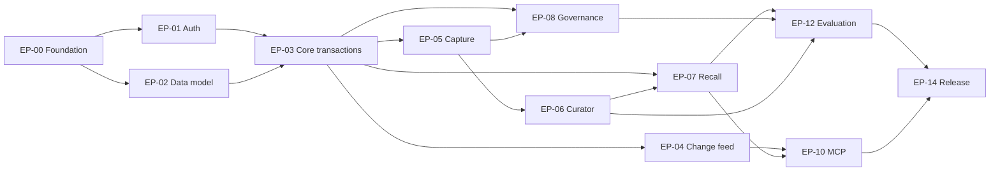

# Thymesis — Development Plan

- Version: 1.0
- Date: 2026-10-14
- Status: **Ready for implementation; no tasks yet executed**
- Product requirements: [../PRODUCT.md](../PRODUCT.md)
- Architecture: [../ARCHITECTURE.md](../ARCHITECTURE.md)

## 0. Delivery outcome and rule

**Goal:** 独立した長期記憶サービスThymesisを、Personal AIの実利用に供する。会話・資料・経験の取り込み、自動整理、根拠付き想起、訂正、差分取得、忘却、復旧までを一貫して実装する。

**Not a technology evaluation project.** PostgreSQL/Workers/Queues/pgvectorを採用ベースラインとし、各段階で利用価値のある縦断経路を完成させる。未実装の部分を「完了」に見せない。技術比較を無期限に繰り返さない。

Release 1のDoneは **PRODUCT.md のFR群とAC-01～13の達成**。Phase 1完成を製品完成と呼ばない。設計段階では決めた契約をOpenAPI/DDL/テストへ落とし込み、変更には根拠付きADRを要求する。

## 1. Workstreams, prerequisites and milestones

### Milestone gates (delivery order)

| Gate | Outcome | Blocking acceptance |
| --- | --- | --- |
| **G0 Contract & skeleton** | 再現可能な開発環境、OpenAPI、DDL、認証境界のテスト雛形 | lint/typecheck/test/migration/CIが通る |
| **G1 Reliable memory core** | Sync Remember/Recall、Evidence、Version、認可、変更差分 | 時間・出典・Scope・競合・Cursorの回帰試験 |
| **G2 Automatic operation** | Capture→Curator→ChangeSet→Commit、Queue、Hybrid Recall | 自動取得・重複・矛盾・障害復旧のE2E |
| **G3 Governance complete** | Forget、Source ACL、Export/Import、MCP、定期再評価 | 不正アクセス/忘却再出現ゼロ、他AIから利用 |
| **G4 Production acceptance** | 品質/性能/コスト/運用監視/バックアップ/リリース | PRODUCT.mdの品質目標とRunbook検証 |

マイルストーンは**機能を切り捨てるためのMVP区分ではなく、依存順序に沿った検収ゲート**とする。

### Epic dependency diagram



## 2. Concrete repository layout

```text
thymesis/
  README.md
  PRODUCT.md
  ARCHITECTURE.md
  docs/
    DEVELOPMENT_PLAN.md
    api/openapi.yaml
    schema/data-dictionary.md
    security/threat-model.md
    runbooks/
    adr/
    eval/
  apps/
    api/               # REST & MCP read/write entrypoints
    worker/            # Queue consumers, scheduled handlers
  packages/
    contracts/         # schemas, error codes, generated types
    domain/            # policy, memory semantics, ChangeSet
    db/                # schema/migrations/query repository/RLS
    curator/           # extraction / consolidation / provider adapter
    recall/            # hybrid retrieval + context pack
    connectors/        # optional, permissioned sources
    observability/
  infra/               # wrangler, Neon, secrets/config templates
  tests/
    unit/
    integration/
    e2e/
    security/
    evaluation/
    load/
```

Technology guidelines:
- TypeScript strict mode、monorepo package workspaces、Vitest、ESLint/formatter、OpenAPI型生成、JSON Schema/Zod等の厳密バリデーション。
- Drizzle等の型付きクエリ/マイグレーションを基準とし、pgvector・pg_trgm・RLSなどはレビュー可能な明示SQLを併用。すべての動的値をパラメータ化。
- Local PostgreSQL (Docker) + Cloudflare Worker local emulation。CIで実際のPostgreSQLに対してmigration/RLS/transactionを試す。SQLite代替では認可・並列制御を評価しない。
- CIから本番データを読ませない。テスト用の架空データと匿名化された実例だけを用いる。

## 3. Epic breakdown (issue-ready)

各Taskは独立Issueにしてもよい粒度とし、受け入れ条件を併記する。

### EP-00 — Foundation, CI/CD and contracts [G0]

Dependencies: none.

| Task | Deliverable / acceptance |
| --- | --- |
| **T-001 Repository bootstrap** | packages/appsとWorkspace、TypeScript strict、lint/typecheck/test。README起動手順と環境変数テンプレート |
| **T-002 Local infrastructure** | PostgreSQL with pgvector/pg_trgm、Queue stub、fake LLM。ワンコマンド起動・停止 |
| **T-003 CI quality pipeline** | push/PRで静的検査、ユニット・integration・migration検証、secret scan、依存監査 |
| **T-004 Environment/deployment** | dev/staging/prod分離、Workers/Neon/Hyperdrive/Queues/Cron構成管理と手順 |
| **T-005 API contract** | OpenAPI v1、エラー型、request_id、idempotency、cursor、scopeの型定義 |
| **T-006 ADR and release discipline** | 技術/権限/データ変更を記録するADRテンプレ、migration review、rollback手順 |
| **T-007 Test fixtures** | 改名/古い方針/相反する主張/経験/PII/攻撃文例を含むfixtureセット |

**Gate G0:** 本番権限なしでCI green。空DB→最新版schema migration→rollback/restore rehearsalが再現可能。OpenAPIサンプルがschema validationを通る。

### EP-01 — Identity, scope and authority [G0→G1]

Dependencies: EP-00.

| Task | Deliverable / acceptance |
| --- | --- |
| **T-010 OAuth integration** | 準拠したAuthorization Serverを選び、JWT/OAuth introspection・issuer/audience/expiry/scope検証 |
| **T-011 Principals and scopes** | Owner/Principal/Scope/Grantとtoken capabilityを設計、read/write/adminを分離 |
| **T-012 App authorization** | すべてのエンドポイントでOwner×Scope×Operation×Source rightsの検査 |
| **T-013 PostgreSQL RLS** | RLS enable、最小権限ロール、SET LOCAL transaction context、pool leak回帰試験 |
| **T-014 Audit and abuse controls** | 秘密を残さない監査、rate limit、request size limit、認証エラー監視 |
| **T-015 Threat model** | prompt injection、権限昇格、token forwarding、データ残存、service impersonationを列挙/対策 |

**Acceptance:** 非許可ユーザー/クライアントでの全経路403/404。コネクション再利用後にも前requestのScopeが見えない。Client A/Bの委任範囲が交差しない。

### EP-02 — Data schema and migrations [G0→G1]

Dependencies: EP-00, EP-01 for final RLS.

| Task | Deliverable / acceptance |
| --- | --- |
| **T-020 Schema migration v1** | owners/scopes/subjects/sources/observations/evidence/episodes/memories/versions/relations/changesets/change_log/outbox等 |
| **T-021 Constraints** | FK、UNIQUE、scope invariant、valid-time検査、不可変Version、別名の重複と多値制約 |
| **T-022 Search columns and indexes** | scope/date/status/subject/relations/pg_trgm、Embedding model/dimension別管理 |
| **T-023 Temporal semantics** | valid_from/toとrecorded_at/superseded_atを実装。未知・遡及訂正のfixture |
| **T-024 Provenance model** | Evidence locator、snippet rights、independent source lineage。derived summaryの再証拠化を防止 |
| **T-025 Data dictionary** | 各カラム、機密性、更新権限、保持期間、Migration strategyを文書化 |
| **T-026 Migration safety** | Schema変更のforward/backfill/rollback、既存件数100万負荷を想定したロック時間試験 |

**Acceptance:** 欠損・cross-scope Relation・不正時刻・削除済み参照などの破壊的変更を制約で拒否。migrationを再適用しても安全。

### EP-03 — Memory Core / explicit Remember / ChangeSet [G1]

Dependencies: EP-01, EP-02.

| Task | Deliverable / acceptance |
| --- | --- |
| **T-030 Sync Remember** | 明示的記憶・訂正を認証された入力と根拠に結び付け、同期確定 |
| **T-031 Revision and CAS** | expected_revisionで楽観的排他。古い更新は409。silent lost updateゼロ |
| **T-032 ChangeSet engine** | CREATE/CORROBORATE/REFINE/SUPERSEDE/CONTEST/RELATE/RETRACT/NO_OPのschemaと検証 |
| **T-033 Atomic commit** | MemoryVersion/Evidence/Relation/ChangeLog/Outboxの原子的更新。失敗時全rollback |
| **T-034 Idempotency** | actor+scope+key+payload hashによる重複防止、結果の再取得 |
| **T-035 Lifecycle & time** | candidate/active/superseded/retracted/contested、過去時点照会の整合 |
| **T-036 Memory detail API** | 根拠、時系列、Version、Subject aliasを認可後に取得 |

**Acceptance:** 明示Remember→直後Get/Recallで一致、二重送信時1件、並列更新時にいずれか409、AI提案をOwner確定扱いにできない。

### EP-04 — Change Feed / consistency / outbox [G1]

Dependencies: EP-03.

| Task | Deliverable / acceptance |
| --- | --- |
| **T-040 Scope offset locking** | Scope別のrow lock付き連番をcommit transactionで発行。rollbackと並列書込試験 |
| **T-041 Opaque cursor** | tokenにscope集合/offset/auth_epoch/format versionを安全に内包。改竄拒否 |
| **T-042 Change API** | order/limit/page/next_cursor、削除Tombstone、再試行、Cursor期限切れ処理 |
| **T-043 Multi-scope sync** | Scopeごとのcursor vector、権限変更時の無効化と再同期 |
| **T-044 Outbox dispatcher** | DB outboxをQueueへ重複安全に配送、Cronによる取り残し回収 |
| **T-045 Index visibility** | committed vs indexed revision、lag中の読み取りフォールバック |

**Acceptance:** 2 writer×大量並列書込/rollback/pagination/reconnectでイベントの欠落・順序逆転がない。削除本文をイベントに載せない。

### EP-05 — Capture and source ingestion [G1→G2]

Dependencies: EP-02, EP-03, EP-04.

| Task | Deliverable / acceptance |
| --- | --- |
| **T-050 Capture API** | Source metadata、speaker、event time、content locator、consent/scope、job_idを受理 |
| **T-051 Source adapters contract** | chat/document/tool-result/episodeの共通入力Schema。原本連携は疎結合 |
| **T-052 Duplicate detection** | source revision+location+content hash+operation IDで重複を吸収 |
| **T-053 Queue consumer** | accepted/processing/held/committed/failed状態、retry/backoff、DLQ |
| **T-054 Source access lifecycle** | source revision、ACL失効通知、原本不存在、再取り込み方針 |
| **T-055 Backfill import** | 旧会話/資料を過去時点として取り込み、現在の方針を上書きしない |
| **T-056 Provenance/audit** | 原本確認できない場合の扱い、取り込み範囲の明示と追跡 |

**Acceptance:** 3回以上のQueue重複配送でもSource/Observation/Job重複なし。権限なしSourceをインデックス・Recallしない。BackfillでもTemporal correctness維持。

### EP-06 — Curator and memory consolidation [G2]

Dependencies: EP-03, EP-05, EP-07 retrieval candidate API.

| Task | Deliverable / acceptance |
| --- | --- |
| **T-060 Provider adapter** | LLM interface + structured output + model/prompt version + timeout/token metering。OpenAI adapterを参照実装 |
| **T-061 Candidate extraction** | Fact/Decision/Preference/Hypothesis/Experience/Procedureの候補と根拠Span |
| **T-062 Subject resolution** | 人名/プロジェクト名の同一性、別名、有効期間。曖昧なら保留 |
| **T-063 Candidate matching** | Lexical/semantic/subject/timeに基づく既存記憶候補取得 |
| **T-064 Reconcile policy** | create/corroborate/refine/supersede/contest/relate/retract/no-op。evidence independence |
| **T-065 Safe auto-commit** | authenticated Owner指示のみOwner authority。LLMの自己申告で権限昇格しない |
| **T-066 Human review queue** | high-impact conflict/candidateの保留・説明・承認・拒否API |
| **T-067 Feedback/evolution** | AI作業結果（retrieved/used/validated）と再評価trigger |
| **T-068 Reprocess** | prompt/model更新後の再抽出を冪等に行い、明示決定は保護 |

**Acceptance:** AI提案→Owner決定誤認0件、古い資料の最新方針上書き0件、同じサマリーの根拠水増し0件（固定回帰セット）。複数LLM失敗時はhold/failして正本を破壊しない。

### EP-07 — Recall Engine and indexing [G1→G2]

Dependencies: EP-02, EP-03; Curator candidate matching requires this epic's internal search.

| Task | Deliverable / acceptance |
| --- | --- |
| **T-070 Structured/exact recall** | ID/subject/current decisions/time/lifecycleで索引に頼らず取得 |
| **T-071 Lexical search** | pg_trgm、名前/表記揺れ/日本語短語の評価と部分一致 |
| **T-072 Embedding pipeline** | Version別Embeddingを非同期作成。モデルDimension/versionを記録 |
| **T-073 Hybrid retrieval** | lexical+semantic+structured、重複削除、関連展開、適用時点/根拠の制約 |
| **T-074 Ranking and budgets** | token budget、重要な根拠とuncertaintyを残すContext Pack |
| **T-075 Recall modes** | precise/contextual/historical/exploratory/changesの契約とcoverage |
| **T-076 Fallback/rebuild** | Embed遅延、Provider障害、reindex中でも正本基準で安全に回答 |
| **T-077 Retrieval evaluation** | Recall@5、誤採用率、根拠欠落、日本語検索、権限境界の測定 |

**Acceptance:** sync Rememberのindex lag中のRecallが成功、仮説/Contestedを確定情報と混ぜない、権限外候補が検索に入らない。token超過でも根拠を欠落させない。

### EP-08 — Forget, retention and source rights [G3]

Dependencies: EP-01, EP-03, EP-04, EP-05, EP-07.

| Task | Deliverable / acceptance |
| --- | --- |
| **T-080 Forget API** | scope/selector/authorization、対象展開、状態取得、request ID |
| **T-081 Immediate suppression** | 正本トランザクションでdenyを確定し全Recall/Export/Change経路から遮断 |
| **T-082 Physical purge** | MemoryVersions、Evidence snippets、Embedding、Views/Cache、不要なOutbox payloadを消去 |
| **T-083 Tombstone & non-resurrection** | content-free tombstoneとsource suppression、再取り込み防止 |
| **T-084 Source ACL revocation** | 権利喪失による即時遮断と関連派生Memoryの再評価 |
| **T-085 Backup reconciliation** | Restore→最新忘却台帳適用→Read可視性ゼロを検証 |
| **T-086 Retention policy** | 期限切れ/自動失効・保存期間・バックアップ保持期間を文書化し実装 |

**Acceptance:** Forgot content is unavailable immediately; purge status eventually reaches purged; rebuild/replay/restore後にも該当本文が復活しない。削除を監査本文に漏らさない。

### EP-09 — Export / Import and portability [G3]

Dependencies: EP-02, EP-03, EP-08.

| Task | Deliverable / acceptance |
| --- | --- |
| **T-090 Export schema** | Memory/Version/Subject/Evidence/Relation/Time/Source linkを含む版付き形式 |
| **T-091 Encrypted export** | 所有者認可、短期URL、期限切れ削除、機密レベル反映 |
| **T-092 Import validation** | schema version/owner/scope/rights/id mapping/idempotency |
| **T-093 Round trip** | Export→fresh DB Import→根拠/履歴/想起の一致比較 |
| **T-094 Deleted-data policy** | 忘却対象をExportに含めない。進行中Exportも抑止 |

**Acceptance:** 出典と変更履歴を失わず移行可能。輸入内容が新しい現在時刻の決定として誤認されない。

### EP-10 — Remote MCP adapters [G3]

Dependencies: EP-01, EP-03, EP-04, EP-07, EP-08.

| Task | Deliverable / acceptance |
| --- | --- |
| **T-100 MCP read-only endpoint** | recall/get_changes/get_memoryのみに限定した独立入口・認可 |
| **T-101 MCP write-capable endpoint** | capture/remember/forget等を明示委任、二重の権限検証 |
| **T-102 OAuth resource metadata** | 現行MCP Authorization仕様に従うissuer/audience/resource/scopeの実装 |
| **T-103 Client E2E** | 少なくとも2種のAIクライアントからログイン・Recall・更新 |
| **T-104 Tool description and limits** | AI向けの短く正確なTool description、入力制限、失敗とRetryの指示 |

**Acceptance:** read-only tokenでは書込不可、audience混同不可、切断・再接続で整合。MCP AdapterとRESTで記憶が一致。

### EP-11 — Scheduled maintenance and self-healing [G2→G3]

Dependencies: EP-04, EP-05, EP-06, EP-07, EP-08.

| Task | Deliverable / acceptance |
| --- | --- |
| **T-110 Time/expiry triggers** | 記憶の時効・Source revision変化で対象のみ再評価 |
| **T-111 Periodic review** | stale/contested/unindexed/orphanedの限定巡回、全件LLM再推論を避ける |
| **T-112 Index repair** | 新旧Embedding generation比較、バックフィル、model migration |
| **T-113 Queue recovery** | 不達Outbox/DLQ/失敗Jobの再投入と冪等性 |
| **T-114 Feedback loop** | 作業結果から知識の適用条件を改訂候補化。使用頻度≠真実性 |

**Acceptance:** Provider停止・Queue失敗・Indexer遅延から正常復帰し、現行Memoryを毀損しない。Cronの再実行でも二重変更なし。

### EP-12 — Quality harness and evaluation [G2→G4]

Dependencies: Core, Curator, Recall, Governanceの縦断経路。

| Task | Deliverable / acceptance |
| --- | --- |
| **T-120 Golden datasets** | temporal、claims/authority、conflict、abstention、experience、permissions、forgetを分類した評価集 |
| **T-121 Baseline comparison** | No memory / conversation summary / Thymesisを同条件の代表タスクで比較 |
| **T-122 Retrieval quality** | Recall@5、context precision/coverage、evidence trace、誤古情報率 |
| **T-123 End-task quality** | タスク成功率、訂正回数、投入token、想起経路別の原因分析 |
| **T-124 Model regressions** | Curator/Embedding/Rerankerのバージョン変更時に再計測 |
| **T-125 Adversarial tests** | Poisoning、injection、source spoofing、scope crossing、forget resurrection |
| **T-126 Repeatable reports** | 再現可能な評価コマンドとレポート、変化量、標本数、失敗例 |

**Acceptance:** PRODUCT.mdの品質目標を固定評価セットに対して満たす。公開ベンチマークは補助で、実ワークフローに対する評価を必須とする。

#### Evaluation fixtures (minimum)

| Category | Minimum cases | Representative tests |
| --- | ---: | --- |
| Temporal/renaming | 30 | Awhen→Ariadne、遡及訂正、当時の認識 |
| Authority/provenance | 30 | AI提案 vs Owner決定、第三者主張 |
| Conflicts/duplicates | 30 | 重複根拠、適用範囲差、矛盾 |
| Retrieval/unknown | 30 | 無知の保留、token budget、日本語名称 |
| Experience/procedures | 30 | 失敗→解決→条件差で不成立 |
| Security/forget/ACL | 40 | Scope漏洩、撤回、復元、再取り込み |
| Async/concurrency | 30 | retry、rollback、Cursor、race |
| **Total** | **220** | リリース前の最低限。標本を増やして統計評価 |

品質指標の分母と判定条件を明記する。例えばRecall@5は質問単位の正解記憶集合との照合、false-current-rateは時間依存質問における古い情報の現行事実化率。ゼロ件要件は全ケース合格とし、統計的な安全性保証とは称さない。

### EP-13 — Observability, infrastructure and cost [G3→G4]

Dependencies: All service paths partially functional.

| Task | Deliverable / acceptance |
| --- | --- |
| **T-130 Dashboards** | capture queue、curation failures、recall latency、DB/Index lag、purge、scope-denied、cost |
| **T-131 Tracing/log redaction** | trace_idでAPI→Queue→DBを追跡、PII/秘密/Memory原文をログに出さない |
| **T-132 Backup/PITR** | 取得・復元、RPO/RTOテスト、忘却再適用 |
| **T-133 Operational runbooks** | Neon障害、Queue backlog、LLM outage、認証失効、Source revocation、Forget失敗 |
| **T-134 Cost reporting** | provider別token、embedding、CPU/DB、Queue、storage、backup、月額総費用 |
| **T-135 Alerts** | error budget、DLQ滞留、Outbox lag、Purge未完了、index divergenceに通知 |
| **T-136 Load and soak tests** | 100k/500kおよび1m/5m workload（PRODUCT.md）で性能・コスト計測 |
| **T-137 Security review** | Secrets/permission/RLS/API scope/audit/forgetをチェックし所見を閉じる |

**Acceptance:** 失敗したJob・欠落しそうなChange・削除未完了を検知でき、Runbookで復旧可能。月額総額が説明可能。

### EP-14 — Release, interoperability and acceptance [G4]

Dependencies: EP-00～13.

| Task | Deliverable / acceptance |
| --- | --- |
| **T-140 Staging soak** | Realistic synthetic workloadで連続稼働、エラーと遅延を計測 |
| **T-141 Multi-agent smoke** | AI client A→Remember、B→Recall/changes、A→Forget、B→not found |
| **T-142 Product acceptance** | PRODUCT.md AC-01～13、FRへのtraceability、未達なし |
| **T-143 Security and privacy gate** | データ権利、Secrets、RLS、Source revoke、Forget、バックアップを検収 |
| **T-144 Release docs** | API reference、運用手順、トラブルシュート、変更履歴 |
| **T-145 Deployment and rollback** | 本番デプロイ、監視、スモーク、rollback/recovery rehearsal |
| **T-146 Evidence report** | 受け入れの実測値、評価再現手順、既知の制約を署名/Commitで固定 |

**Acceptance:** 全受入契約と運用ゲート達成。既知の失敗は隠さず、契約未達ならRelease不可。

## 4. Execution order and parallelization

小規模チーム（1～2人）を想定したクリティカルパス：

1. **Foundation + Auth + Schema**（EP-00/01/02）：API境界、DB制約、再現可能なCIを先に確立。
2. **Core + Cursor + minimal exact Recall**（EP-03/04/07部分）：明示記憶→即時取得→差分。まず一貫性のある縦断経路。
3. **Capture + Curator + hybrid Recall**（EP-05/06/07残）：自動記憶獲得と価値提供を完成。
4. **Governance + MCP + maintenance**（EP-08/09/10/11）：削除・認可・複数AIでの運用を完成。
5. **Quality/cost/security + release**（EP-12/13/14）：完成形の検収。

評価Fixtureと監視は各Epicの開始時から追加し、最後だけで一気に試験しない。

参考工数（見積もり、納期保証ではない）：**70～110 engineer-days**。内訳の目安：foundation/auth/schema 15～22、core/cursor 12～18、capture/curator/recall 22～35、governance/MCP 12～18、品質/運用/リリース 9～17。作業結果に応じて見積もりを更新する。外部OAuth連携と忘却・RLSの困難性が主な変動要因。

## 5. Definition of Done (every issue)

- 設計意図・API契約・Data ownershipが明記されている。
- 少なくともunit/integ/e2eの該当テストを追加。負荷・権限・失敗経路は関連するEpicで必ず追加。
- Migration/rollbackとデータ消去の影響を確認（対象外なら理由を明記）。
- CI（typecheck/lint/test/security）がgreen。
- 暗黙のmodel selectionやCredentials、権限バイパス、秘密のログ出力なし。
- 操作のidempotency、timeout、failure status、traceを実装。
- Acceptance evidenceをIssue/PRに残す。計測値には実行条件・バージョン・サンプル数を添える。
- PRODUCT.md/ARCHITECTURE.mdとの差異があれば同じPRで更新する。

## 6. Risk register and decisions

| Risk | Impact | Mitigation / stop condition |
| --- | --- | --- |
| Curatorの誤統合 | 方針・経験の破損 | 根拠とScope、期待Revision、hold、再評価 |
| LLMのコスト増大 | 運用費用の超過 | event-driven処理、cache可能な非機密部分、モデル計測・バッチ |
| Vector SearchのScopeフィルタ欠落 | 誤検索・漏洩 | SQL/RLS優先、post-filterだけに依存しない |
| Cursorのcommit-order race | 消費側で差分喪失 | Scope行ロック、rollbackと並列のテスト |
| Source rightsの失効遅延 | プライバシー漏洩 | 検出後即時deny、定期権利確認、fail closed |
| 忘却後の派生情報再出現 | 信頼・プライバシー破壊 | non-content tombstones、purge graph、restore reconciliation |
| Hyperdrive pool/RLS context漏洩 | Cross-scope漏洩 | SET LOCAL transaction-only、専用権限role、統合テスト |
| LLM/provider API障害 | Capture遅延・Recall品質低下 | outbox/retry/DLQ、read path fallback |
| 日本語の検索品質不足 | Recall@5未達 | 固定評価集、pg_trgm/lexical/vectorの重み調整 |
| 単一Scopeのwrite lock競合 | 書き込み遅延 | 実測。高負荷で必要時に範囲分割を検討 |
| ドキュメントと実装の乖離 | 誤利用・品質劣化 | OpenAPI/DDL/evalをCIに組み込み、ADR記録 |

### Non-goals for this release

- メモリの価値を示す前に追加の専用Graph DB/Vector DBを配置すること。
- AriadneのActionをThymesisへ二重保存して別の正本を作ること。
- 原本の永久コピーや、Ownerの同意なきコネクタ全件取り込み。
- 人間が毎日レビューしなければ動かないCurator運用。
- ベンチマークだけ高得点で実利用のタスク成果が測れないリリース。

## 7. Production runbook checklist

Release G4の納品には次のRunbookと実演記録を含める。

- [ ] OAuth署名鍵/Client credential失効・切替
- [ ] OwnerのScope grant取り消し、source rights即時反映
- [ ] DBバックアップ/復元と復元後Forget再適用
- [ ] LLM停止時のCapture再試行とsafe fallback
- [ ] Queue/DLQ/outboxの滞留復旧
- [ ] Index再生成中のRead-after-write確認
- [ ] Forget failureの再試行と完了証跡
- [ ] 異常なtoken/CPU/storage課金の原因特定と制限
- [ ] RLS/Scope/Versionのschema migration
- [ ] 外部AIクライアントのOAuth/MCP connectivityチェック
- [ ] Data export/importの本人確認と一時成果物削除

## 8. Evidence to retain for acceptance

`docs/eval/`以下に（本番秘密を含まない）再現可能な実行条件と結果を記録する：

1. Golden dataset version、評価クエリ、expected memories、ground truth。
2. LLM/provider/model/prompt/Embedding versions、検索パラメータ、テストSeed。
3. Recall@5、task QA、未知保留率、false-current率、p95 latency、token数・月額推定/実費。
4. RLS/forget/Cursor/並列/復元テストの結果と失敗時ログの匿名化版。
5. Contract traceability：FR/AC→Issue/PR/自動試験/実測→結果。

完了時には次の文を実証できること：**「複数AIが、現在有効で根拠付きの長期記憶を安全に共有でき、変更・忘却・障害・復旧を含めて継続的に運用できる。」**
