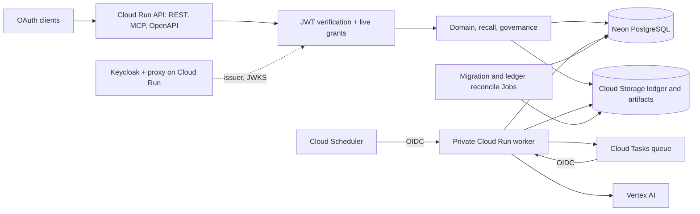

# Service infrastructure

## Runtime and topology

The service is TypeScript on Node.js 24, using `node:http` servers, node-postgres (`pg`), the official MCP TypeScript SDK and Zod schemas. One immutable container image serves two Cloud Run services and the Cloud Run Jobs. Domain, recall and governance code do not depend on Cloud Run, Google SDKs or a particular model provider; cloud adapters are selected by configuration at the composition root.

Services listen on `$PORT` and expose `/healthz` (process only) and `/readyz` (database and deletion-ledger readiness; `503 restore_not_ready` while a restored database is unreconciled). Cloud Run startup probes use `/readyz`, so a revision that cannot verify the ledger never receives traffic. Instances keep no session, cursor or job state in memory.

## HTTP boundaries

| Service | Route | Contract |
| --- | --- | --- |
| API | `/v1/*` | REST operations; bearer token for the API resource |
| API | `POST /mcp/read`, `POST /mcp/write` | Streamable HTTP MCP; separate resources, audiences and tool sets |
| API | `/.well-known/oauth-protected-resource/mcp/read`, `.../mcp/write` | Public protected-resource metadata naming the issuer, resource and scopes |
| API | `/openapi.json`, `/healthz`, `/readyz` | Public; no memory data |
| Worker | `POST /internal/jobs/run` | Cloud Tasks delivery of one `job_id` |
| Worker | `POST /internal/dispatch/sweep` | Scheduler sweep: outbox dispatch, due-job retry, governance and portability passes |
| Worker | `POST /internal/governance/sweep` | Local fixture mode only; disabled in `cloud-tasks` mode |

Request bodies are limited to 1 MiB, JSON is required, and the API applies a per-address rate limit (120 requests per minute per instance) before authentication. MCP requests are rejected unless Host and Origin match `MCP_ALLOWED_HOSTS` and `MCP_ALLOWED_ORIGINS`, preventing DNS-rebinding access. Error responses are typed and carry a request ID; they never echo memory content.

## Identity and access

Keycloak 26.8.1 is the OAuth authorization server. It runs in its own Cloud Run service with a Node proxy sidecar: ingress reaches only the proxy, which accepts the exact public host, replaces forwarding headers, and forwards only realm discovery, authorization, token, revoke, logout, JWKS, login and required-action routes, static resources and a narrow set of user account-console pages and methods. Administration, master realm, client registration and unrecognized paths are rejected before forwarding. The identity service is the only service with public invocation.

Keycloak runs `start --optimized` with JDBC-ping cache discovery, a bounded database pool, HTTP bound to loopback, trusted proxy addresses limited to loopback and PostgreSQL TLS verification (`sslmode=verify-full`) through the identity JDBC secret. The service runs with minimum 0 and maximum 1 instances; Keycloak gets 1 vCPU and 2 GiB and the proxy the smallest valid allocation, and the proxy starts only after the Keycloak startup probe succeeds. The runtime identity receives only the identity database URL and password; the bootstrap administrator and the user's initial password reach only the one-time bootstrap Job. Resource indicators are experimental in Keycloak, so any Keycloak upgrade repeats the real PKCE and audience smoke before rollout.

The realm has self-registration disabled, brute-force protection, short access-token lifetimes and no refresh-token reuse. Clients are preregistered with authorization code, PKCE S256, consent and one exact loopback redirect URI; password and implicit grants, wildcard redirects and dynamic client registration are disabled. Resource indicators bind each token to exactly one resource: the API, `/mcp/read` or `/mcp/write`. Tokens carry `memory:read`, `memory:write` or `memory:admin` capabilities and a `scope_ids` claim that only administrators can edit.

The API verifies issuer, signature against the configured JWKS, lifetime, exact audience and scope claims. Verified subjects map to stored principals; their capabilities and scope IDs are intersected with active, unexpired grants on every request and again inside each operation, and scope authorization epochs invalidate stale authorization. User-only operations require the user's own principal; business arguments cannot select an user.

Cloud Run IAM protects the worker: only the dedicated task-invoker and scheduler-invoker service accounts hold `roles/run.invoker`, and both mint OIDC tokens for the worker's canonical custom audience. The API service is also IAM-private at present; operators reach it with a Cloud Run ID token in `X-Serverless-Authorization` while the application token stays in `Authorization`. The procedure for renaming realm, clients and scopes in place is in [identity cutover](identity-cutover.md).

## Persistence

Neon PostgreSQL with the pgvector and pg_trgm extensions is the only durable store for tenant data. Each service holds one bounded `pg` pool and runs every tenant operation in a transaction that sets user, principal and scope context with transaction-local settings. Runtime logins (`memory_app` for the API, a separate worker login that is a member of `memory_worker`) are non-superuser, `NOBYPASSRLS` and do not own tables; forced row-level security applies to every tenant table. The migration identity is separate and its credential never reaches a service. The [data model](data-model.md) defines tables, constraints and transaction contracts.

## Asynchronous delivery

`TASK_DISPATCH_MODE` selects `local-http` (Compose fixture with a shared token and polling) or `cloud-tasks`. In cloud mode the worker requires `WORKER_PRIVATE_IAM=true` and rejects fixture configuration. Tasks have random names, a body containing only `job_id`, an OIDC token for the canonical worker audience and a 600-second dispatch deadline. The queue allows 2 concurrent dispatches, 2 dispatches per second, 5 attempts within 3,600 seconds and 10–300 second backoff.

Cloud Run starts no timers. Cloud Scheduler calls `/internal/dispatch/sweep` once a minute with OIDC. Each sweep dispatches up to 50 outbox rows, retries up to 100 due capture jobs, then runs a bounded governance pass, a portability pass and a second governance pass so that Forget can complete after export files are removed. Deletion recovery reads at most 100 requests per call and backs off failed requests. Remaining work stays durable for the next sweep. Job status, attempts, last error and next retry time live in PostgreSQL; no queue-level dead-letter storage is assumed.

## Governance storage

`STORAGE_MODE=gcs` with `GCS_LEDGER_BUCKET` and `GCS_ARTIFACT_BUCKET` selects Cloud Storage; otherwise the local filesystem stores are used. Prefixes default to `ledger/` and `artifacts/`.

The deletion ledger is an append-only chain: immutable node objects under `ledger/objects/` and a single mutable `ledger/HEAD.json` updated by generation-conditioned compare-and-swap. Custom roles limit runtime identities to creating and reading nodes and to updating the head object; ledger nodes cannot be overwritten or deleted. A new ledger namespace is bootstrapped once, after an empty-database check, by a separate setup principal; runtime identities never bootstrap. The artifact bucket holds encrypted export bundles with object versioning disabled, soft delete off, uniform bucket-level access and public access prevention, so a deleted artifact is gone.

## Model providers

`CURATOR_PROVIDER` selects `vertex`, `openai-compatible` or `local` explicitly; there is no fallback between providers. The `local` provider is a deterministic test fixture.

In Vertex mode, extraction uses `gemini-3.5-flash` through the regional `generateContent` endpoint in `asia-southeast1` with JSON response mode and a structural response schema derived from the strict proposal schema. Every proposal is then parsed with the full schema and its statements are validated as exact anchors in the original observation before any commit. Request and response bodies are bounded to 1 MB, output to 4,096 tokens, and each call to a 30-second default deadline (`CURATOR_PROVIDER_TIMEOUT_MS`, 1–120 seconds). Embeddings use `gemini-embedding-001` with 1,536 dimensions, fixed to the recall index contract. Credentials come from the service account through Application Default Credentials; no API key or static token is configured.

## Resource configuration

[deployment.json](../../infra/cloud/deployment.json) is the declarative source for names, limits and secret references; [iam-contract.json](../../infra/cloud/iam-contract.json) declares the direct IAM bindings. These are configured values, not measured results.

| Setting | API | Worker |
| --- | --- | --- |
| Region | asia-southeast1 | asia-southeast1 |
| Min / max instances | 0 / 2 | 0 / 2 |
| Concurrency | 8 | 1 |
| Request timeout | 60 s | 600 s |
| CPU / memory | 1 vCPU / 1 GiB | 1 vCPU / 2 GiB |
| pg pool maximum | 5 | 5 |
| Invocation | IAM-private | IAM-private; task and scheduler invokers only |

Neon runs in AWS `ap-southeast-1` (Singapore), close to the Cloud Run region. With two instances per service and five connections per pool, one revision uses at most 20 runtime connections; overlapping revisions during a rollout and Jobs add to that. Do not raise maximum instances without checking the database connection budget.

Secrets live in Secret Manager and are referenced by version: application and worker database URLs, the migration URL, the Forget HMAC key, the portability master key, cursor HMAC keys and the identity database credentials. Each service account can read only its declared secrets.

## Monitoring and objectives

Logs carry request ID, route template, status, error class and duration. They never include statements, evidence, embeddings, tokens, database URLs or secret values. Worker diagnostics report counts and checkpoint metadata only.

Latency, availability, quality and cost targets are defined in the [product requirements](../design/requirements.md#service-targets). Dashboards, alerts, load and soak tests, Neon point-in-time recovery and measured RPO/RTO are not yet in place; see the [cloud verification register](../eval/cloud-verification.md) for what has been observed.

## Naming cutover

The running services, identity realm, Neon database and buckets still carry the former Thymesis names. `deployment.json` declares the Lore-named target resources, which stay inactive until the identity realm, database state and bucket contents have been migrated and read back. Follow [deployment](deployment.md) for the sequence and preservation rules.
