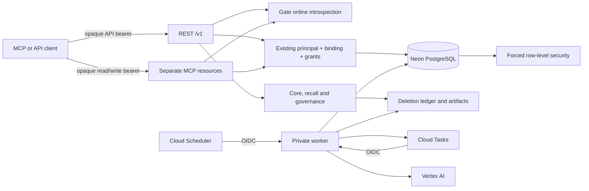

# Service infrastructure

## Runtime and topology

The service is TypeScript on Node.js 24. One immutable container image serves the Cloud Run API, private worker and controlled jobs. The API exposes REST, Remote MCP and OpenAPI. Neon PostgreSQL with pgvector and pg_trgm stores user data and work state; Cloud Tasks delivers durable job IDs; Cloud Scheduler triggers worker sweeps; Cloud Storage holds the deletion ledger and encrypted exports; Vertex AI supplies extraction and embeddings.

Gate owns sign-in, approvals, sessions and logout. This service consumes Gate through online bearer-token introspection and an operator-maintained binding to an existing Lore identity. The API uses a public HTTPS entry point with Gate bearer checks for protected data, while the worker remains private. The checked-in `infra/cloud/deployment.json` is a synthetic example profile, not the private production configuration or a deployment readback. Current rollout status belongs to [deployment](deployment.md).

## HTTP boundaries

| Service | Route | Contract |
| --- | --- | --- |
| API | `/v1/*` | REST; API-resource Gate bearer only |
| API | `POST /mcp/read`, `POST /mcp/write` | Streamable HTTP MCP; separate resource audiences, credentials and tool sets; Gate bearer only |
| API | `/.well-known/oauth-protected-resource/mcp/read`, `.../mcp/write` | Public metadata naming Gate, resource URI and supported OAuth scopes |
| API | `/openapi.json`, `/healthz`, `/readyz` | Health and schema; no memory data |
| Worker | `POST /internal/jobs/run` | Cloud Tasks delivery of one `job_id` |
| Worker | `POST /internal/dispatch/sweep` | IAM-authenticated scheduler sweep |

The API rejects duplicate Authorization headers before Node's header normalization. Cookie headers do not participate in authentication: cookie-only requests fail, and cookies accompanying a valid bearer token are ignored. CORS is non-credentialed and allows only configured `API_ALLOWED_ORIGINS`; bearer authentication does not depend on Origin. MCP validates Host and supplied Origin to prevent DNS rebinding. Request bodies are bounded and error responses do not echo memory content. `/auth-return.html` and `/v1/session` are absent and return 404.

## Gate identity and admission

Gate issues opaque authorization-code tokens for the API, MCP read and MCP write resources. Each resource has its own client ID and secret for introspection; the audiences are the configured public API origin and its `/mcp/read` and `/mcp/write` paths. The verifier discovers Gate's OIDC metadata and introspection endpoint, checks active status, issuer, immutable subject, approved client and exact audience, and fails closed when Gate is unavailable. It does not verify local JWT/JWKS tokens or cache successful authorization.

An operator must map an exact `(Gate issuer, subject, client ID)` tuple in `external_identity_bindings` to an existing Lore user and principal. The binding contains an explicit scope list and capability ceiling; current, unexpired database grants, source rights and authorization epochs further restrict access. OAuth consent alone never creates a Lore user or grants memory access. The mapping tool hashes both the existing principal/grant snapshot and target binding before it applies.

MCP clients own their OAuth callback and send the resulting Gate bearer token to Lore. Lore does not start Gate login, resume a Gate browser session, or expose a device-logout flow. Users manage sign-in, approvals, sessions and logout in Gate; OAuth client grants remain independently revocable there.

Every actor-bound operation locks and compares the local binding, principal, grants and source rights. The transaction runs one final Gate check immediately before COMMIT. If the identity, local binding, grant, rights or Gate service is unavailable or changed, the operation fails without committing. PostgreSQL RLS remains forced; application and worker roles are non-superuser and `NOBYPASSRLS`.

## Worker, storage and deployment boundary

Cloud Run IAM protects the worker: task and scheduler identities invoke it using the worker's canonical Cloud Run audience. The public API invocation boundary is separate from application authorization: protected data still requires a valid Gate bearer and current Lore grants. The API's Cloud Run URL remains its canonical service identity.

`deployment.json` is a synthetic example for names, limits, resource URLs and secret-reference shape; `iam-contract.json` records the intended direct IAM boundary. Neither is itself a cloud readback. Current deployed values, readbacks and remaining acceptance work belong in [deployment](deployment.md) and its dated [release record](../eval/gate-production-release-20261018.md).

## Monitoring and remaining limits

Logs carry request ID, route template, status, safe error class and duration, never statement text, evidence, tokens, database URLs or secret values. Restore readiness compares the database checkpoint with the independent deletion-ledger head and fails closed until reconciliation.

The local Gate harness and hosted acceptance checks exercise different boundaries. The [deployment record](deployment.md) links current production readbacks; [verification design](testing.md) describes what local and hosted tests establish.
