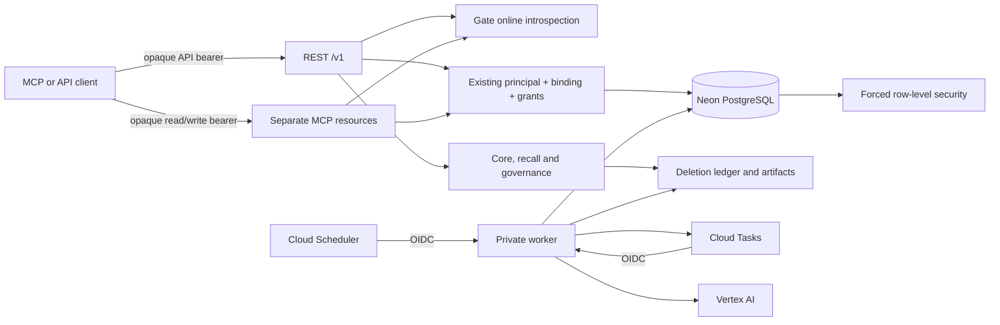

# Service infrastructure

## Runtime and topology

The service is TypeScript on Node.js 24. One immutable container image serves the Cloud Run API, private worker and controlled jobs. The API exposes REST, Remote MCP and OpenAPI. Neon PostgreSQL with pgvector and pg_trgm stores user data and work state; Cloud Tasks delivers durable job IDs; Cloud Scheduler triggers worker sweeps; Cloud Storage holds the deletion ledger and encrypted exports; Vertex AI supplies extraction and embeddings.

Gate owns sign-in, approvals, sessions and logout. The source implementation and public endpoint contract live in the sibling Gate service; this repository consumes Gate through online bearer-token introspection. Production has a public HTTPS API origin, and a real Gate browser login and approval were confirmed. This API-only source correction is pending deployment; positive hosted MCP data access remains unverified. The checked-in `infra/cloud/deployment.json` is a synthetic example profile; it is not the private production configuration or a cloud readback.

## HTTP boundaries

| Service | Route | Contract |
| --- | --- | --- |
| API | `/v1/*` | REST; API-resource Gate bearer only |
| API | `POST /mcp/read`, `POST /mcp/write` | Streamable HTTP MCP; separate resource audiences, credentials and tool sets; Gate bearer only |
| API | `/.well-known/oauth-protected-resource/mcp/read`, `.../mcp/write` | Public metadata naming Gate, resource URI and supported OAuth scopes |
| API | `/openapi.json`, `/healthz`, `/readyz` | Health and schema; no memory data |
| Worker | `POST /internal/jobs/run` | Cloud Tasks delivery of one `job_id` |
| Worker | `POST /internal/dispatch/sweep` | IAM-authenticated scheduler sweep |

The API rejects duplicate Authorization headers before Node's header normalization. Cookie headers do not participate in authentication: cookie-only requests fail, and cookies accompanying a valid bearer token are ignored. CORS is non-credentialed and allows only configured `API_ALLOWED_ORIGINS`; bearer authentication does not depend on Origin. MCP validates Host and supplied Origin to prevent DNS rebinding. Request bodies are bounded and error responses do not echo memory content. `/auth-return.html` and `/v1/session` are absent and return 404.

## Gate identity and admission

Gate issues opaque authorization-code tokens for the API, MCP read and MCP write resources. Each resource has its own client ID and secret for introspection; the audiences are the configured public API origin and its `/mcp/read` and `/mcp/write` paths. The verifier discovers Gate's OIDC metadata and introspection endpoint, checks active status, issuer, immutable subject, approved client and exact audience, and fails closed when Gate is unavailable. It does not verify local JWT/JWKS tokens or cache successful authorization.

An operator must map an exact `(Gate issuer, subject, client ID)` tuple in `external_identity_bindings` to an existing Lore user and principal. The binding contains an explicit scope list and capability ceiling; current, unexpired database grants, source rights and authorization epochs further restrict access. OAuth consent alone never creates a Lore user or grants memory access. The mapping tool hashes both the existing principal/grant snapshot and target binding before it applies.

MCP clients own their OAuth callback and send the resulting Gate bearer token to Lore. Lore does not start Gate login, resume a Gate browser session, or expose a device-logout flow. Users manage sign-in, approvals, sessions and logout in Gate; OAuth client grants remain independently revocable there.

Every actor-bound operation locks and compares the local binding, principal, grants and source rights. The transaction runs one final Gate check immediately before COMMIT. If the identity, local binding, grant, rights or Gate service is unavailable or changed, the operation fails without committing. PostgreSQL RLS remains forced; application and worker roles are non-superuser and `NOBYPASSRLS`.

## Worker, storage and deployment boundary

Cloud Run IAM protects the worker: the task and scheduler identities invoke it using the worker's canonical Cloud Run audience; inherited operator access remains unchanged. The API's Cloud Run URL remains the canonical IAM identity. Production uses the approved direct Cloud Run domain-mapping design; the public API invoker is applied and its HTTPS certificate is Ready. The worker remains private and its IAM boundary is unchanged.

`deployment.json` is a synthetic example for names, limits, resource URLs and secret-reference shape; `iam-contract.json` records the intended direct IAM boundary. Neither is itself a cloud readback. Current hosted state, secret version references and pending acceptance work are recorded in the [deployment status](deployment.md) and the [2026-10-18 release record](../eval/gate-production-release-20261018.md).

The surrounding runtime remains GCP project `syntoria` in `asia-southeast1`, with `lore-api` (2 instances, concurrency 8, 60-second requests, pool max 5) and `lore-worker` (2 instances, concurrency 1, 600-second tasks, pool max 5). The worker's canonical audience remains its Cloud Run URL. Neon database `lore` is in AWS `ap-southeast-1`; the previously observed hosted baseline was 41 applied migrations through 0041, while this checkout adds migration 0042. `lore-capture` dispatches at most 2 tasks concurrently and 2 per second, and `lore-worker-sweep` runs once per minute. The migration and ledger-reconcile jobs, ledger/artifact buckets and their object-prefix IAM are unchanged by the Gate implementation. These are declared configuration values; use the verification register for observed state.

## Monitoring and remaining limits

Logs carry request ID, route template, status, safe error class and duration, never statement text, evidence, tokens, database URLs or secret values. Restore readiness compares the database checkpoint with the independent deletion-ledger head and fails closed until reconciliation.

The local actual-Gate harness proves bearer-token resource separation against the local Gate implementation and Firestore Emulator, with synthetic GitHub exchange and isolated PostgreSQL. Local checks cover removed Lore login/session routes, cookie-only rejection, bearer REST access, MCP access and grant revocation. In production, the public HTTPS boundary and Gate browser login/approval were confirmed; positive MCP data access remains unverified. The [API-only correction record](../eval/api-only-gate-auth-correction-20261019.md) tracks deployment and acceptance.
