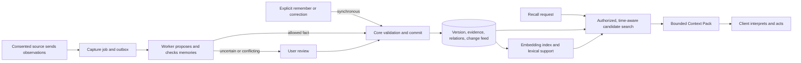

# Memory system: from observation to recall

This document follows one decision through Lore's actual write, capture and retrieval paths. It explains what the service stores, how a proposal becomes a revision, and what a recall result can and cannot say. The public shapes are in the [data model](data-model.md) and [MCP/API contract](mcp-api.md); relevant implementation is linked at the end.

Imagine an AI suggests a database, then you decide to wait until the finished-product requirements are settled. Later, another AI asks what the project decided. Lore must preserve two different claims, make the decision's evidence inspectable, keep its attribution separate from truth, and return the useful version without suggesting that a missing result proves nothing was ever said.

## Two ways information enters

An explicit `remember` request takes the synchronous core path. Lore validates the request and writes a `CREATE` through the same ChangeSet commit transaction used by other changes. The caller receives the committed result; it does not wait for a curator model to decide what the user meant. What kind of memory is created and whether it is active or a candidate still follow the authenticated actor, supplied epistemic status and core policy. A request cannot set authority. Lore admits a Gate issuer and subject rather than an individual OAuth client. When the binding names a connection principal, every client of that subject writes as that non-user principal, so its memories receive `ai_proposal` authority whatever status it declares, and user authority comes only from a change the person approved at Gate. Without a connection principal, a client acts as the user principal and must send `proposed` for its own suggestions.

Capture is a separate, asynchronous path. A user-authorized connector must be enabled with consent, and a client sends Lore source observations; Lore does not fetch a provider's conversation history or crawl documents on its own. Each observation keeps its source identity and revision, locator, content, speaker, event time and lineage root. Replayed source observations are deduplicated by source revision, canonical locator and content hash. The capture transaction stores the observations, job and outbox work together so a worker can resume after delivery failure.

The worker claims a job under a lease and may checkpoint the provider response before validation. A curator proposal contains a memory kind, statement, context, subject and time fields, epistemic status, contested flag and one or more spans into supplied observations. The worker verifies that each span points to the exact cited source text and that the source still has consent and rights. For an episode, the proposal must preserve a complete condition, action and outcome as one experience; a partial fact proposal is held as invalid output.

The model proposes content, but does not choose authority or commit policy. The worker removes duplicate proposals from one response, searches existing memories, and routes anything outside a narrow automatic path to user review. Automatic capture is limited to an uncontested `fact` with `observed` or `inferred` status, usable source evidence, read permission for reconciliation, no unresolved match (or one sole exact active duplicate), and bounded statement and evidence sizes. A sole exact duplicate can attach corroborating evidence to the same memory identity by creating a new revision. Preferences, decisions, contested proposals, uncertain status and ambiguous matches are held for review. Invalid evidence is rejected or held; prompt instructions alone do not make evidence valid.

## Evidence, attribution and truth

An observation records what a source said or what happened. An evidence link records which observation supports a particular memory revision, including its locator and any permitted snippet. Revisions have their own evidence sets; refining a statement cannot silently inherit unrelated evidence. Lineage distinguishes independent observations from a source replay or a derived summary, so copying a summary does not manufacture corroboration.

Speaker, authenticated actor and authority answer different questions. Speaker metadata identifies who the source says spoke. The authenticated actor identifies which authorized principal submitted a write. For ordinary writes, core authority is derived from the actor kind, memory kind and epistemic status: a user decision or preference receives its corresponding user authority; other user-authored kinds are user assertions; a non-user actor or a `proposed` status receives `ai_proposal` authority. Controlled user-review operations may record a separate user statement. Imports use a separate trust rule: the importing principal becomes the current author and imported claims receive `third_party_claim` authority, while the previous attribution remains provenance. Model-supplied authority is ignored.

These rules preserve provenance, not objective truth. A user-authored technical claim can remain an assertion. A reviewer's confirmation records what the user chose to state or accept; it is not an independent measurement of the outside world. No single trust score turns source identity into proof.

## Revisions, operations and time

Changes to existing memories use a ChangeSet. A proposal is validated and persisted first; commit then rechecks authorization, source rights and every `expected_revision`. A stale revision fails with a conflict rather than overwriting another writer. Model calls stay outside the transaction. A successful commit atomically writes the memory version, version-specific evidence, relations, per-scope change event, outbox record, idempotency response and audit metadata.

`recorded_at` says when Lore learned a revision. `valid_from` and `valid_to` say when the claim applies. Historical retrieval first selects the latest revision known by `known_at`, then applies `valid_at` to that revision. It does not substitute an older revision just because its interval is wider. Current source rights and Forget suppressions still apply to historical requests.

The operations carry different meanings. `REFINE` creates a new revision with a sharper statement or context; `SUPERSEDE` closes the earlier valid-time interval and creates a replacement memory; `RETRACT` records that a memory was wrong; `CONTEST` marks a disputed memory with evidence; and `CORROBORATE` attaches evidence to the same memory identity by creating a new revision with a new evidence set. `contested` is an epistemic flag, while candidate, active, superseded, retracted and forgotten describe lifecycle. A public non-user write, or any proposed-status write, starts as a candidate. A non-proposed write by the user can start active. Separately, a worker may activate a fact that passes the narrow automatic-capture policy through its controlled internal path. Only the user can supersede or retract an active memory, and non-user writers cannot refine user-attributed memories.

An AI's successful use of a memory does not change its truth or authority. Feedback (`useful`, `incorrect`, `stale` or `not_relevant`) is stored and queued for reassessment; it does not itself revise the memory. Current maintenance can move queued feedback into a held state, so callers should not promise an automatic correction from feedback alone.

## Retrieval and Context Packs

PostgreSQL memory versions remain the source of truth. Lexical matching uses statements, structured context, subjects and time-bounded aliases; pgvector matches embeddings only for the same model and dimension. Capture commits can submit their memories for embedding indexing, and a bounded worker sweep repairs stale indexes. An index row is accepted only if it still matches the committed revision. Because indexing can lag, recall checks eligible committed records and reports `embedding_index_lag_fallback`. Exact and lexical queries can still surface an unindexed record, but a semantically related query may miss it until indexing catches up. When the embedding provider is unavailable, non-precise search reports `semantic_index_unavailable` and continues with available signals.

Every search applies requested scopes, current source rights and suppression, lifecycle, valid-time and optional known-time filters. Candidate memories are hydrated with their version evidence and checked again before return. Candidate memories are excluded except in exploratory mode. `precise` mode uses exact statement, subject or alias matching and does not add lexical, semantic or relation candidates. `changes` is a separate change-oriented mode; clients that need a complete ordered sequence should use the signed change feed.

The other recall modes combine bounded candidate lists. Exact matches have weight 4, lexical matches 1.5, semantic matches 1.5 and relation matches 0.45. The service merges their ranks with weighted reciprocal-rank fusion, `weight / (60 + rank + 1)`. By default, each source list is limited to `min(200, query.limit * 8)`, and the query limit is at most 100. Relation expansion starts from at most 50 supported roots and follows at most two hops. These are candidate-generation limits, not a promise to search every memory or relation. Historical mode gives exact candidates priority before the fused score. The default minimum semantic similarity is 0.18; a lexical similarity of at least 0.2 can independently support a returned candidate.

The resulting Context Pack contains returned memory objects, their evidence and attribution, retrieval signals, uncertainty, index revisions, contested memory IDs, insufficiencies and scope coverage. `conflicts` is the set of returned memories already marked contested; it is not a pairwise contradiction detector and does not enumerate every disagreement in storage. `coverage.complete` reports the embedding-provider and index-coverage state used for this response; it does not mean that search was exhaustive or that every fact is known. `unknown` means no supported match was returned under the query and its bounds, not that the requested fact does not exist.

The field `estimated_tokens` is calculated from the UTF-8 byte length of the complete JSON-serialized Context Pack, not by a model tokenizer. That byte count is the implementation's budget measure; it is not an exact count of tokens the receiving model will use. When the pack does not fit, Lore drops lower-ranked matches while retaining the status and coverage metadata, and reports budget insufficiency.

## Forget and restore

Forget is distinct from retracting a wrong statement. The user-authorized Forget transaction records the request, adds suppressions and a content-free change event, and makes the selected content unavailable immediately. An independent deletion ledger records the durable deletion instruction; a worker then purges memory versions, evidence and dependent data and reports progress. Protected reads fail closed while ledger state is unavailable or a restored database has not caught up with the ledger. A backup may retain deleted bytes until backup retention expires, but restore reconciliation must apply the deletion record before serving reads.

Source-rights revocation is also separate from Forget. Current rights checks block dependent evidence, recalled memories and affected exports; source revocation does not rewrite historical attribution into a user statement. AI clients do not receive changes automatically: each client must recall again or advance its own authorized change cursor. Deleted items in the feed are content-free notices.

## Source links

- [Core ChangeSet, authority, revisions and historical reads](../../packages/domain/src/core-service.ts)
- [Observation capture and consent](../../packages/connectors/src/index.ts)
- [Capture validation, reconciliation, review and retries](../../packages/jobs/src/index.ts)
- [Curator proposal and provider contracts](../../packages/curator/src/index.ts)
- [Bounded candidate search, rank fusion, Context Pack and index maintenance](../../packages/recall/src/index.ts)
- [Forget, feedback, purge and restore checks](../../packages/governance/src/forget-service.ts)
- [Deletion-ledger representation](../../packages/governance/src/deletion-ledger.ts)
- [Portable import trust boundary](../../packages/governance/src/portability-service.ts)
- [Persistence, source rights and deletion constraints](../../packages/db/migrations/)
